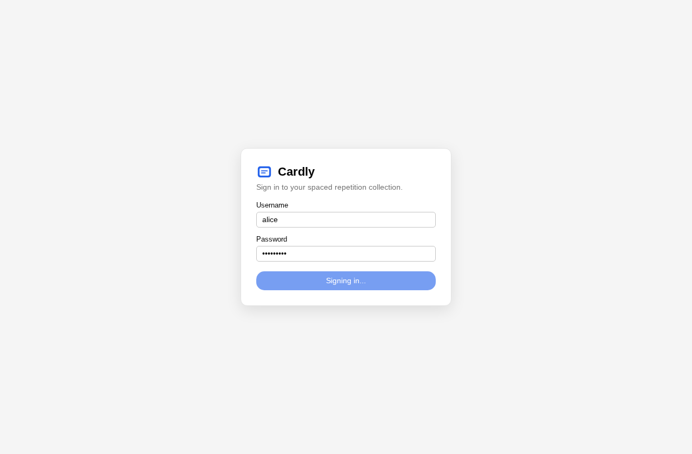
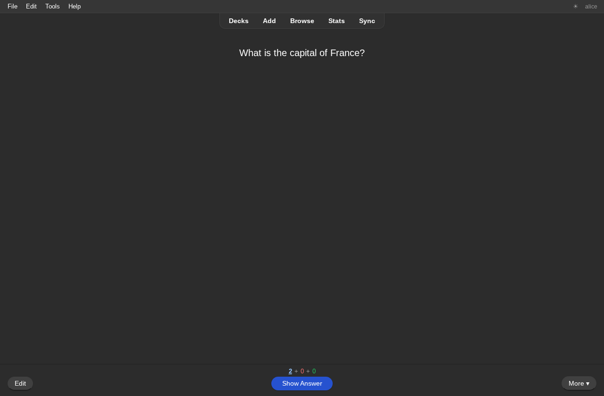
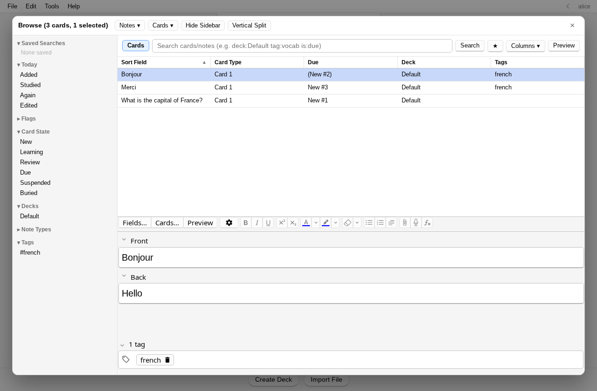
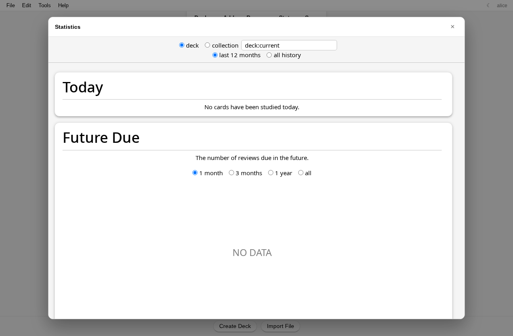
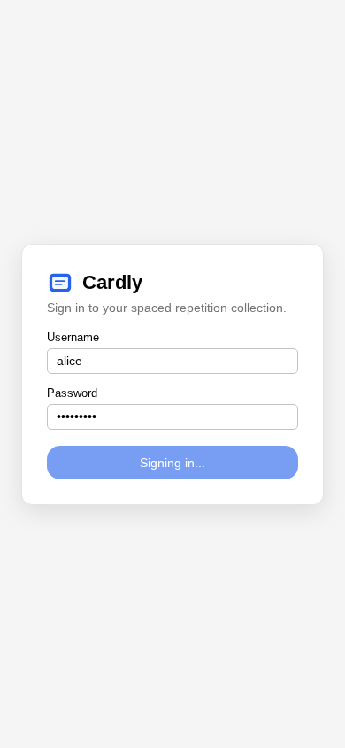

<p align="center">
  <picture>
    <source media="(prefers-color-scheme: dark)" srcset="docs/brand/cardly-logo-dark.svg">
    <source media="(prefers-color-scheme: light)" srcset="docs/brand/cardly-logo-light.svg">
    
  </picture>
</p>

<p align="center">
  <strong>Fast, self-hosted web client for Anki collections, powered directly by Anki's official Rust core.</strong>
</p>

<p align="center">
  <a href="./LICENSE"></a>
  <a href="https://github.com/ankitects/anki"></a>
  <a href="https://my-cardly.duckdns.org"></a>
  <a href="#quickstart"></a>
  <a href="./docs/PARITY.md"></a>
</p>

<p align="center">
  <b>English</b> • <a href="docs/i18n/README.ru.md">Русский</a> • <a href="docs/i18n/README.kk.md">Қазақша</a>
</p>

<p align="center">
  <a href="#quickstart">Quickstart</a> •
  <a href="#why-cardly">Why Cardly</a> •
  <a href="#interface-preview">Screenshots</a> •
  <a href="#ankiweb--desktop-comparison">Comparison</a> •
  <a href="#mobile-sync">Mobile Sync</a> •
  <a href="#configuration">Configuration</a> •
  <a href="./docs/PARITY.md">Parity Matrix</a>
</p>

---

<p align="center">
  
</p>

> **Disclaimer**: Cardly is an independent open-source project and is not affiliated with, endorsed by, or sponsored by Ankitects Pty Ltd or Damien Elmes. "Anki" is a trademark of its respective owner. Cardly incorporates upstream open-source code from Anki's official backend library (`rslib`) under the GNU AGPL-3.0 license.

---

## 🌐 Live Public Demo

Experience Cardly directly in your browser without local installation:

👉 **[Try the Live Demo](https://my-cardly.duckdns.org)** *(Instant guest access — no sign-up needed)*  
🌐 **[Project Showcase & Landing](https://orkensab.github.io/cardly/)**

> [!NOTE]
> **Demo Environment Limits:**
> - **Automated Reset**: The demo collection automatically resets back to clean sample decks every 2 hours and on container restarts. Do not use the demo instance for permanent personal study data.
> - **AI Generator**: The AI card generator is disabled by default in the public demo to prevent API quota exhaustion. Self-host Cardly with Docker to connect your own local Ollama, Gemini, or OpenAI keys.
> - **Resource Quotas**: Uploads are capped at 10 MiB per file with a 50 MiB storage quota per session.

---

## Quickstart

Run Cardly with Docker Compose:

```bash
# 1. Clone repository with upstream submodule
git clone --recurse-submodules https://github.com/OrkenSab/cardly.git
cd cardly

# 2. Configure credentials
cp .env.example .env

# 3. Start container
docker compose up -d
```

Open **`http://localhost:8080`** in your browser. Log in using the credentials defined in `.env` (default: `alice` / `supersecretpassword`).

To stop:
```bash
docker compose down
```

---

## Why Cardly?

Desktop Anki is reliable, but requires installing Python and Qt dependencies on every computer. AnkiWeb is accessible anywhere, but provides only a minimal study interface without a card browser, template editor, or FSRS weight optimizer.

Cardly gives you a complete, self-hosted web workspace running on your own server:

- **Official Anki Rust Core (`rslib`, Anki 26.09.4)**: We do not approximate or rewrite spaced repetition algorithms in JavaScript. Interval calculation, fuzzing, retention curves, and the **FSRS-6 scheduler, same as upstream Anki 26.09.4** (backward compatible with older FSRS v4/v5 parameters) run through upstream Anki Rust code.
- **Desktop-Grade Card Browser**: Virtualized 3-pane browser built for large collections (100,000+ notes). Supports Anki search queries (`deck:`, `tag:`, `is:due`, `prop:reps>5`), saved searches, and batch operations (suspend, tag, find & replace, export).
- **Built-in Sync Server**: Uses Anki's own sync protocol (`/sync/*` and `/msync/*`, verified with Anki Desktop). AnkiDroid and AnkiMobile: not yet tested, reports welcome (see [docs/SYNC_TESTING.md](docs/SYNC_TESTING.md)).
- **In-Browser FSRS Optimizer**: Train personalized 21-parameter FSRS-6 weights (or keep existing 17/19-parameter FSRS v4/v5 weights) and run retention simulations directly from your review logs.
- **Card Templates & Media**: Client-side MathJax 3, nested cloze deletions (`{{c1::...}}`), HTML5 audio/video, image occlusion, and a split-screen HTML/CSS template editor with live preview.
- **AI Card Generator**: Create atomic Q&A or cloze cards from lecture notes or textbook photos using local Ollama models or cloud providers (Gemini, OpenAI, OpenRouter).
- **Self-Hosted Data Ownership**: Multi-user accounts with isolated SQLite collections (`collection.anki2`) and media stores. Automatic rolling snapshots before sync and schema changes.

---

## Interface Preview

| Deck Overview | Dark Mode Reviewer |
| :---: | :---: |
|  |  |
| **3-Pane Card Browser** | **Retention & Forecast Stats** |
|  |  |

<p align="center">
  
  <br>
  <em>Mobile PWA layout: bottom navigation bar, safe-area insets, and 44px touch targets.</em>
</p>

---

## AnkiWeb & Desktop Comparison

| Feature | Desktop Anki | AnkiWeb | Cardly |
| :--- | :--- | :--- | :--- |
| **Environment** | Local desktop (Python / PyQt6) | Proprietary cloud service | Self-hosted web app & PWA |
| **Core Scheduling** | Upstream `rslib` (Rust) | Custom web backend | Upstream `rslib` (Rust) linked directly |
| **FSRS-6** | Scheduler + Optimizer + Simulator | Review only | Scheduler + Optimizer + Simulator (same as Anki 26.09.4) |
| **Card Browser** | Full 3-pane browser | Basic search list | Full 3-pane virtualized browser |
| **Template Editor** | Split HTML/CSS editor | Limited | Split HTML/CSS editor with live preview |
| **Math & Media** | MathJax, LaTeX, audio/video | MathJax, basic audio | MathJax 3, HTML5 audio/video, Web TTS |
| **Sync Server** | Client only | Cloud server | Built-in sync server for mobile & desktop |
| **Mobile Access** | Separate native apps | Basic responsive web | Installable PWA + direct sync to mobile apps |
| **Data Storage** | Local user disk | AnkiWeb servers | Self-hosted Docker volume (isolated per user) |
| **Add-ons** | PyQt Python add-ons | Not supported | Built-in features (FSRS, stats, AI generator) |

---

## Mobile Sync

Cardly uses Anki's own sync protocol (`/sync/*` and `/msync/*`, verified with Anki Desktop). AnkiDroid and AnkiMobile: not yet tested, reports welcome (see [docs/SYNC_TESTING.md](docs/SYNC_TESTING.md)):

### AnkiDroid (Android)
1. Open **AnkiDroid** &rarr; **Settings** &rarr; **Syncing** &rarr; **Custom sync server**.
2. Enable **Use custom sync server**.
3. Set **Sync url**: `http://<YOUR_SERVER_IP>:8080/sync/`
4. Set **Media sync url**: `http://<YOUR_SERVER_IP>:8080/msync/`
5. Return to the main screen, tap **Sync**, and enter your `CARDLY_USER1` credentials.

### AnkiMobile (iOS)
1. Open **AnkiMobile** &rarr; **Preferences** &rarr; **Syncing** &rarr; **Custom Server**.
2. Set **Sync URL**: `http://<YOUR_SERVER_IP>:8080/sync/`
3. Enter your username and password, then tap **Sync Now**.

> [!TIP]
> When accessing your server over public Wi-Fi or the internet, run Cardly behind an HTTPS reverse proxy (such as Caddy or Nginx) with automated TLS certificates, and set `CARDLY_COOKIE_SECURE=true`.

---

## Configuration

Cardly reads environment variables from `.env` in the project root:

| Variable | Default | Description |
| :--- | :--- | :--- |
| `CARDLY_PORT` | `8080` | Host port for the web app and sync server. |
| `CARDLY_HOST` | `0.0.0.0` | Bind address inside the container. |
| `CARDLY_DATA_DIR` | `./data` (host) / `/data` (container) | Persistent directory storing user collections, media files, and backups. |
| `CARDLY_USER1` | *Required* | First user credentials in `username:password` format. |
| `CARDLY_USER2`, `...` | *Optional* | Additional user accounts. Each account receives an isolated collection. |
| `PASSWORDS_HASHED` | `0` | Set to `1` if passwords specified in `CARDLY_USER*` are pre-hashed PBKDF2 strings. |
| `CARDLY_SESSION_SECRET` | *Auto-generated* | Secret key for signing session cookies. Saved to `$CARDLY_DATA_DIR/.session_secret`. |
| `CARDLY_COOKIE_SECURE` | `false` | Set to `true` when serving behind an HTTPS reverse proxy. |
| `CARDLY_MAX_UPLOAD_MB` | `512` | Maximum allowable file size in MiB for `.apkg`, `.colpkg`, and media uploads. |
| `RUST_LOG` | `cardly_server=info,anki=info` | Tracing log level filter for the backend server. |

---

## Local Development & Testing

If you want to contribute to Cardly or run it without Docker:

### Prerequisites
- **Rust** 1.80+ (`cargo`)
- **Node.js** 20+ / 22+ (`npm`)
- **SQLite3** and **protobuf** build tools

### Build & Run
```bash
# 1. Build frontend shell
cd web
npm install
npm run build
cd ..

# 2. Run backend server
CARDLY_USER1="alice:secret123" \
CARDLY_PORT=8080 \
CARDLY_SHELL_DIR="./web/dist" \
CARDLY_UPSTREAM_WEB_DIR="./anki-upstream/out/qt/_aqt/data/web" \
cargo run --manifest-path server/Cargo.toml
```

### Running Test Suites
```bash
# Backend integration tests (Protobuf RPC and Anki sync protocol)
cargo test --manifest-path server/Cargo.toml --test integration

# Frontend type checking
npm --prefix web run check

# Playwright End-to-End tests (desktop and mobile flows)
npm --prefix e2e run test
```

---

## Documentation Links

- [Parity Matrix (`docs/PARITY.md`)](./docs/PARITY.md) — Detailed verification status for every Anki feature.
- [AI Generator Guide (`docs/AI_GENERATOR.md`)](./docs/AI_GENERATOR.md) — Setup instructions for Ollama, Gemini, and OpenAI.
- [Production Deployment (`docs/DEPLOY.md`)](./docs/DEPLOY.md) — Caddy reverse proxy, TLS setup, and backup strategies.
- [Roadmap (`docs/ROADMAP.md`)](./docs/ROADMAP.md) — Near-term priorities and experimental ideas.
- [Contributing Guide (`CONTRIBUTING.md`)](./CONTRIBUTING.md) — Code style, pull request guidelines, and issue triage.

---

## License & Attribution

Cardly is licensed under the **GNU Affero General Public License, version 3 or later** ([GNU AGPL-3.0-or-later](./LICENSE)).

Cardly is built upon the Anki open-source project:
- **Upstream Repository**: [https://github.com/ankitects/anki](https://github.com/ankitects/anki)
- **Original Author & Maintainer**: Damien Elmes and the Anki contributors
- **Upstream License**: GNU AGPL-3.0-or-later (with portions under BSD-3 and MIT licenses)

See the [NOTICE](./NOTICE) file for third-party software notices and contributor acknowledgments.
