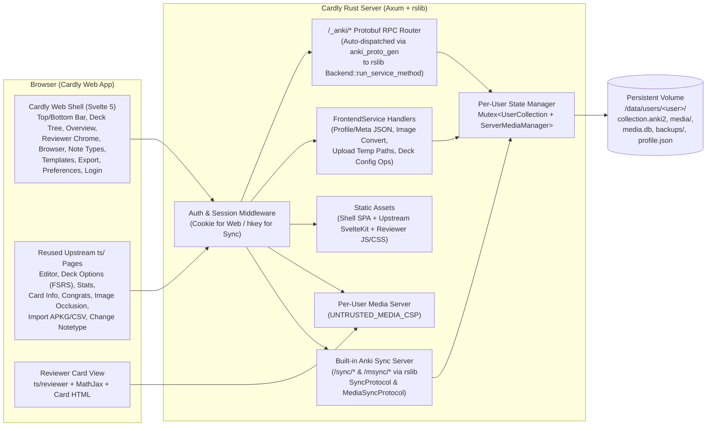

# Cardly — Architecture & Implementation Plan

> **Status:** Phase 0 (Research & Architecture Planning) — awaiting confirmation before Phase 1 implementation.
> **Upstream base:** `ankitects/anki` @ commit `0302650` (`./anki-upstream`), licensed under **GNU AGPL-3.0-or-later**.
> **Product name:** **Cardly** (placeholder name; no Anki name or logo in product UI).

---

## 1. Architecture Decision & Justification

### Recommended Approach: Server-Hosted `rslib` (Rust/Axum) + Reused `ts/` Pages + Custom Web Shell

We recommend keeping Anki's Rust core (`rslib`) on the server inside a single Rust **Axum** binary, exposing the exact same protobuf-over-HTTP RPC protocol (`POST /_anki/<method>`) that `qt/aqt/mediasrv.py` uses, serving the upstream compiled `ts/` SvelteKit pages and reviewer runtime directly, and building the missing desktop-shell screens (the parts Qt owns) as a TypeScript/Svelte 5 web shell. Everything runs in a single container (or minimal Docker Compose stack) with per-user persistent volumes.

### Alternative Evaluated: `rslib` Compiled to WASM + SQLite in OPFS (Client-Side)

We audited `anki-upstream/rslib/Cargo.toml` to evaluate compiling `rslib` to `wasm32` with browser OPFS SQLite for offline-first execution:

| Dimension | Server-Hosted `rslib` (Recommended) | `rslib` -> WASM + SQLite OPFS |
|---|---|---|
| **Upstream Reuse** | **Zero fork of `rslib`.** Our server crate links `anki = { path = "../anki-upstream/rslib" }` directly. | **Heavy invasive fork.** `rslib` unconditionally depends on native C/OS crates (`rusqlite` bundled C, `tokio` multi-thread, `axum`, `hyper`, `reqwest`, `rayon`, `zstdmt`, `dirs`, `tempfile`, `std::fs`, `std::thread`). |
| **FSRS Optimization** | Full multi-core native speed via `rayon`. | Single-threaded WASM (or complex SharedArrayBuffer/COOP/COEP worker pool); 10x–50x slower on large revlogs. |
| **Large `.apkg` / `.colpkg` & Media** | Streams natively on server filesystem with zstd/zip; handles multi-GB decks easily. | Browser memory/OPFS quota limits; mobile Safari OPFS quirks; large zips can OOM tabs. |
| **Multi-Device & Mobile Sync** | Built-in! `rslib` already ships `SyncProtocol` + `MediaSyncProtocol` (`rslib/src/sync/http_server`). AnkiDroid, AnkiMobile, and Desktop Anki sync natively with Cardly. | Still requires a backend server anyway to sync between devices and back up data. |
| **Offline Browser Use** | Requires network connection to self-hosted server. (For offline mobile studying, she uses AnkiDroid/AnkiMobile synced against Cardly.) | Works offline in a browser tab without a server. |
| **Maintenance & Upgrades** | Pulling upstream `anki` updates is straightforward (`git pull` + rebuild). | Every upstream `rslib` change risks breaking custom WASM shims. |

**Recommendation:** Proceed with **Server-Hosted `rslib` (Axum)** as preferred. It delivers 100% authentic scheduler/FSRS/templating/search/import-export behavior with zero `rslib` fork and unlocks native AnkiDroid/AnkiMobile/Desktop sync almost for free.

### Key Architectural Design Decisions

1. **Unified Server-Mode Collection (`server: true`) for Built-in Sync Compatibility**
   - `rslib`'s `Backend::new(tr, /*server:*/ true)` was built specifically so a web app (AnkiWeb) and sync server can mutate the same collection: when `server: true`, every mutation writes a positive server USN (`self.storage.usn(true)` in `rslib/src/collection/mod.rs`), so syncing clients (AnkiDroid/AnkiMobile/Desktop Anki) pick up browser reviews and edits via normal incremental sync.
   - **Per-user locking:** Each user has one `Arc<Mutex<UserRuntime>>` holding both their `Backend` (with `Collection` open on `collection.anki2` + `media/` folder) and `ServerMediaManager` (`media.db` + `media/`). Web RPCs and `/sync/*` + `/msync/*` requests acquire the same lock, eliminating SQLite lock races.
   - **Media USN bridging:** Whenever a web RPC adds or removes media (`addMediaFile`, `addMediaFromUrl`, `trashMediaFiles`, `.apkg` import), the server registers the file delta in `ServerMediaManager` so AnkiDroid/Desktop media sync stays in lockstep.
   - **Timezone handling:** In `server: true` mode, `rslib/src/scheduler/mod.rs` reads the user's UTC offset from collection config (`localOffset`) rather than the server container's OS clock. Cardly will sync/allow setting the user's timezone offset from browser `Intl` / `getTimezoneOffset()` so day rollovers match her local timezone accurately.
   - **Tradeoff to confirm:** Running with `server: true` makes Cardly act *as* her self-hosted Anki sync server (her phone/desktop syncs *to* Cardly). Cardly itself does not act as a sync client *to* official AnkiWeb simultaneously. (If she wants to import her existing Anki collection into Cardly, she can either import a `.colpkg` export or point Desktop Anki's custom sync server at Cardly and force-upload once.)

2. **Automatic Protobuf RPC Dispatch**
   - `rslib/proto/typescript.rs` already generates `out/ts/lib/generated/backend.ts` with typed async functions for **every** RPC across all `.proto` services, sending `POST /_anki/<camelCaseMethod>` with `Content-Type: application/binary`.
   - On the server, we read the exact same `anki_descriptors.bin` via `anki_proto_gen::get_services(&pool)` to build a `HashMap<String, (u32, u32)>` mapping `<camelCaseMethod> -> (service_idx, method_idx)` and dispatch straight to `Backend::run_service_method(service, method, bytes)`. No hand-coding 200+ endpoints!

3. **Security & Isolation for Untrusted Card JS**
   - Anki cards frequently include user/shared-deck JavaScript (for example, Japanese pitch-accent scripts, interactive cloze/buttons, custom scheduling hooks).
   - In Desktop Anki (`qt/aqt/mediasrv.py`), `_APIKEY` (`Authorization: Bearer ...`) prevents untrusted card JS from calling mutation RPCs; only a tiny whitelist (`getSchedulingStatesWithContext`, `setSchedulingStates`, `i18nResources`, `congratsInfo`) is allowed from reviewer frames.
   - In Cardly, we replicate this exact defense-in-depth:
     - Cardly's trusted shell and trusted `ts/` routes receive a per-session `X-Cardly-Api-Token` header (injected into `postProto`) required for `/_anki/*` RPCs.
     - The Reviewer renders card HTML inside a dedicated sandboxed/isolated iframe (or separate origin/tokenless context) that can load media (`/<filename>`) and call only the reviewer's postMessage bridge + the 4 whitelisted reviewer RPCs — never arbitrary collection mutations.
     - Collection media files are served with `mediasrv.py`'s exact `UNTRUSTED_MEDIA_CSP` (`default-src 'none'; script-src 'none'; sandbox allow-same-origin; ...`).
     - File-path-taking RPCs (`importAnkiPackage`, `importCsv`, `exportAnkiPackage`, `addMediaFromPath`, `openCollection`) are **never** exposed to arbitrary server paths; uploads go through `POST /api/uploads` into the user's isolated `tmp/` dir and are resolved via opaque upload IDs.

4. **AGPL-3.0 Compliance & Branding**
   - Repository carries `GNU AGPL-3.0-or-later` (`LICENSE`), retains all upstream copyright headers and `anki-upstream/CONTRIBUTORS`, and includes an AGPL §13 source-code notice/link in Cardly's About dialog.
   - Product UI uses **"Cardly"** branding and custom icons/favicon (zero Anki name or Anki logo in the UI). We strip or override any hardcoded "Anki" strings shown in reused `ts/` pages (e.g., via FTL/translation override or small wrapper layer).

---

## 2. Upstream Repository Module Map (`./anki-upstream`)

| Directory | Language / Tech | Purpose | Reuse in Cardly |
|---|---|---|---|
| `rslib/` | Rust (`anki` crate) | Complete Anki core: SQLite storage, schema migrations, v3 scheduler + FSRS (`fsrs` crate), card template rendering & filters, cloze, typed-answer diffing, search parser & browser table formatting (`browser_table.rs`), import/export (`.apkg`, `.colpkg`, CSV/TSV), media management, database/media check, undo/redo, statistics/graphs, backups. | **100% reused directly** as a Cargo dependency of our Rust server. |
| `rslib/proto/` & `rslib/proto_gen/` | Rust (`prost`, `prost-reflect`) | Compiles `proto/anki/*.proto` into `descriptors.bin`, Rust prost structs, Python `_backend.py`, and TypeScript `@generated/backend.ts`. | **100% reused** for RPC dispatch table & TS client generation. |
| `rslib/i18n/` & `ftl/` | Rust (`fluent`) + FTL files | Type-safe localized strings (`core` and `qt` bundles) served to TS via `i18nResources`. | **100% reused** (with Cardly brand string overrides where needed). |
| `rslib/src/sync/` & `rslib/sync/` | Rust (`axum`) | Built-in Anki sync server (`SimpleServer`, `collection_sync_router`, `media_sync_router`, `ServerMediaManager`). | **Reused directly** inside Cardly's Axum server. |
| `proto/anki/` | Protobuf v3 (22 files) | Canonical RPC & storage schema (`backend`, `cards`, `card_rendering`, `collection`, `config`, `deck_config`, `decks`, `frontend`, `generic`, `i18n`, `image_occlusion`, `import_export`, `links`, `media`, `notes`, `notetypes`, `scheduler`, `search`, `stats`, `sync`, `tags`, etc.). | **100% reused** unmodified. |
| `ts/routes/` | SvelteKit 2 / Svelte 5 / TypeScript / Bootstrap 5 | Modern web UI pages: `editor`, `deck-options`, `graphs`, `card-info`, `congrats`, `image-occlusion`, `import-anki-package`, `import-csv`, `import-page`, `change-notetype`, `preferences` (Labs tab only). | **Reused directly** via static SvelteKit build + thin browser bridge shim. |
| `ts/reviewer/` & `ts/mathjax/` | TypeScript / SCSS / MathJax 3 | Card display engine (`_showQuestion`, `_showAnswer`, fade, MathJax lazy loader, typed answer input, custom scheduling state mutation hook, image occlusion review JS). | **Reused directly** inside Cardly's Reviewer card frame. |
| `ts/lib/` | TypeScript / Svelte / SCSS | Design tokens (`sass/_vars.scss`, `_color-palette.scss`, `night-mode.scss`), shared UI components, tag editor, context menus, `postProto`, `bridgeCommand`, i18n loader. | **Reused directly** (including exact Anki light/dark CSS variables!). |
| `qt/aqt/data/web/` | SCSS / TypeScript / SVG | Legacy webview CSS & JS for `toolbar`, `toolbar-bottom`, `deckbrowser`, `overview`, `reviewer-bottom`, `webview`. | **Design & CSS reference** (reused/adapted for pixel-accurate layout & styling). |
| `qt/aqt/` | Python / PyQt6 | Desktop application shell, `mediasrv.py` HTTP server, window manager, menus, shortcuts, native Qt dialogs (Browser, Note Types, Fields, Card Templates, Export, Preferences, Filtered Decks, Custom Study, etc.). | **Study reference only** — replaced by Cardly's Rust server + web shell. |
| `pylib/` | Python + PyO3 (`rsbridge`) | Thin Python wrapper over `rslib` + legacy helpers. | **Not used at runtime** (used only when running upstream Desktop Anki locally for visual comparison). |
| `build/` | Rust (`configure`, `ninja_gen`, `runner`) | Generates `out/build.ninja` to build Rust, protos, FTL, Python, and TS. | Used to build upstream artifacts (`ts/` SvelteKit, generated TS protos, local Desktop Anki reference). |

---

## 3. How Desktop Qt Shell <-> Rust Backend Communication Works

Desktop Anki uses **three distinct communication channels** between its GUI and Rust core:

### Channel A: Protobuf-over-HTTP (`ts/` -> `mediasrv.py` -> `rslib`)
1. `ts/lib/generated/post.ts` sends `POST /_anki/<camelCaseMethod>` with:
   - `Content-Type: application/binary`
   - `Anki-Op-Changes: <0|1|2|3>` (depth of `OpChanges` message in the response protobuf)
   - Raw serialized protobuf request bytes as body
2. `qt/aqt/mediasrv.py` (Flask + Waitress on `127.0.0.1:<port>`) routes the request to either:
   - **`exposed_backend_list`** (~45 methods): forwarded raw to `col._backend.<method>_raw(bytes)` -> PyO3 `rsbridge` -> `Backend::run_service_method(svc, method, bytes)`. If `Anki-Op-Changes > 0`, `mediasrv.py` parses `OpChanges` and triggers `on_op_finished()` on Qt's main thread so all open windows refresh.
   - **`post_handler_list`** (32 custom handlers implementing `proto/anki/frontend.proto`'s `FrontendService` + a few special overrides).

### Channel B: Direct Python-to-Rust FFI (`qt/aqt` -> `pylib` -> `rsbridge` -> `rslib`)
- Native Qt screens (Deck Browser, Overview, Reviewer, Card Browser, Note Types, Fields, Card Templates, Export, Preferences) bypass HTTP and call `col.*` -> `col._backend.<method>()` -> PyO3 `Backend::command(service, method, bytes)` -> `Backend::run_service_method`.
- **In Cardly**, our web shell simply calls those exact same Rust RPCs over **Channel A** (`POST /_anki/<camelCaseMethod>`), because `rslib/proto/typescript.rs` ALREADY generates typed TypeScript functions for ALL backend RPCs in `@generated/backend`!

### Channel C: Qt WebChannel (`pycmd(...)` / `bridgeCommand(...)` & `web.eval(...)`)
- Legacy webviews (`deckbrowser`, `overview`, `reviewer`, `toolbar`, `bottom`) and a small number of Svelte routes invoke `window.bridgeCommand(cmd, cb)` (aliased as `pycmd(cmd)`), which Qt's `QWebChannel` delivers to Python handlers.
- Python pushes updates downward via `web.eval("_showQuestion(...)")`, `web.eval("_showAnswer(...)")`, `web.eval("_drawFlag(...)")`, `web.eval("showQuestion(...)")`, `web.eval("showAnswer(...)")`, etc.
- **In Cardly**, our web shell replaces `QWebChannel` with a lightweight in-browser `window.bridgeCommand` / `postMessage` bridge, and drives `ts/reviewer` directly via JS function calls.

### Complete Handling Plan for All 32 `mediasrv.py` / `FrontendService` Endpoints

| Endpoint(s) | Used By | Cardly Implementation |
|---|---|---|
| `congratsInfo` | `congrats` | Forward directly to `rslib` `SchedulerService::CongratsInfo`. |
| `getDeckConfigsForUpdate`, `updateDeckConfigs` | `deck-options` | Forward to `rslib` `DeckConfigService` (run long FSRS optimization on `tokio::task::spawn_blocking` so `latestProgress` polling works live!). |
| `changeNotetype` | `change-notetype` | Forward to `rslib` `NotetypesService::ChangeNotetypeOfNotes` / `UpdateNotetype`. |
| `getProfileConfigJson`, `setProfileConfigJson`, `getMetaJson`, `setMetaJson` | `editor`, `deck-options`, `preferences` | Server-side per-user JSON store (`/data/users/<user>/profile.json` & `meta.json`). |
| `getConfigJson`, `setConfigJson` | `editor`, `graphs`, etc. | Forward directly to `rslib` `ConfigService`. |
| `convertPastedImage` | `editor` | Server-side (using Rust `image` crate) or browser `<canvas>` conversion to PNG/JPG matching quality (50 PNG / 80 JPG). |
| `getSchedulingStatesWithContext`, `setSchedulingStates` | `reviewer` (custom JS scheduling) | Intercepted in browser Reviewer state (holds current `QueuedCard`'s `states` & `context` in memory for custom card JS). |
| `openFilePicker` | `editor`, `image-occlusion` | Intercepted in browser bridge: opens `<input type="file">`, uploads via `AddMediaFile` (or `/api/uploads`), returns filename/token. |
| `recordAudio` | `editor` | Intercepted in browser bridge: Web `MediaRecorder` modal -> encodes audio -> `AddMediaFile` -> returns filename. |
| `playFile` | `editor` | Intercepted in browser bridge: plays `/<filename>` via HTML5 `<audio>` element. |
| `readClipboard`, `writeClipboard` | `editor` | Intercepted in browser bridge: `navigator.clipboard.read()` / `write()` (with graceful fallback for paste events). |
| `openMedia`, `showInMediaFolder` | `editor` context menu | Intercepted in browser bridge: open media preview/new tab (showInMediaFolder -> download or info toast). |
| `openLink` | `editor`, `deck-options` | Intercepted in browser bridge: `window.open(url, "_blank", "noopener")` for `https:` links. |
| `askUser`, `showMessageBox` | `editor`, `deck-options` | Intercepted in browser bridge: Cardly styled modal confirm/alert dialog returning `Bool`. |
| `searchInBrowser` | `graphs`, `import-page`, `editor` | Intercepted in browser bridge: navigates/opens Cardly Browser with `SearchNode` converted via `buildSearchString`. |
| `deckOptionsReady`, `deckOptionsRequireClose`, `importDone`, `importDialogRequireClose`, `closeAddCards`, `closeEditCurrent` | `deck-options`, `import-*`, `editor` | Intercepted in browser bridge: modal/drawer lifecycle callbacks in the Cardly shell. |
| `openFieldsDialog`, `openCardsDialog` | `editor` | Intercepted in browser bridge: opens Cardly's Fields or Card Templates modal for the editor's current note type. |
| `saveCustomColours` | `editor`, `image-occlusion` | Saves custom color palette to collection config (`customColorPickerPalette`). |

### Complete Handling Plan for `bridgeCommand` Calls in Reused `ts/` Routes
- `graphs/GraphsPage.svelte`: `browserSearch: <query>` -> open Cardly Browser with that query.
- `congrats/CongratsPage.svelte`: `customStudy` / `unbury` -> open Custom Study modal or call `unburyDeck`.
- `reviewer/index.ts`: `ans` -> show answer; `updateToolbar` / `repaintNeeded` -> no-op / update shell chrome; `play:q:N` / `play:a:N` -> HTML5 audio/video playback.
- `editor/*`: `editorReady`, `saved`, `editorState:...`, `preview` (open Card Previewer modal), `dupes` (search duplicates in Browser), `fields` / `cards` (open Fields / Templates modals), `attach` / `record` (file picker / mic recorder), `addImageForOcclusion` (open Image Occlusion modal). (Note: most `bridgeCommand` calls in `NoteEditor.svelte` are gated behind `isLegacy = true`; we run with `isLegacy = false`.)

---

## 4. Desktop Anki Screen & Feature Audit

Every screen, dialog, and feature in `qt/aqt/` and `ts/routes/`, classified as:
- **Reuse (web)** — already implemented in `ts/` SvelteKit or `ts/reviewer/`; reuse upstream build directly.
- **Rewrite (Qt -> Web)** — native PyQt6 widget or Python-generated HTML in `qt/aqt/`; build faithful web equivalent in Cardly shell backed by `rslib` RPCs.
- **Skip / Later** — desktop-only, add-on ecosystem, or low-priority items deferred beyond Phase 2.

### Core App Shell & Navigation

| Screen / Feature | Upstream Location | Classification | Notes |
|---|---|---|---|
| Top Menu Bar (`File`, `Edit`, `Tools`, `Help`) + Keyboard Shortcuts | `qt/aqt/main.py`, `forms/main.ui` | **Rewrite (Qt -> Web)** | Compact menu bar + global shortcuts (`d`, `a`, `b`, `t`, `y`, `Ctrl+Z`, `Ctrl+Shift+Z`, `Ctrl+P`, `Ctrl+Shift+I`, `Ctrl+E`, `Ctrl+Shift+N`, `F`, `S`). |
| Top Navigation Toolbar (`Decks`, `Add`, `Browse`, `Stats`, `Sync`) | `qt/aqt/toolbar.py`, `css/toolbar.scss` | **Rewrite (Qt -> Web)** | Reuses Anki's exact CSS tokens (`toolbar.scss`) & centered pill-bar layout. |
| Bottom Action Bar (context-sensitive per screen) | `qt/aqt/toolbar.py`, `css/toolbar-bottom.scss` | **Rewrite (Qt -> Web)** | Context-aware: Deck Browser (`Create Deck`, `Import File`), Overview (`Options`, `Custom Study`, `Description`), Reviewer (`Edit`, `Show Answer` / `Again·Hard·Good·Easy`, `More`, timer). |
| Account Login / Auth Screen | *(New for Cardly)* | **Rewrite (New)** | Simple username + password login, session cookie, logout. |
| Undo / Redo + Toast Notifications | `qt/aqt/undo.py`, `utils.py` (`tooltip`) | **Rewrite (Qt -> Web)** | Backed by `rslib` `getUndoStatus`, `undo`, `redo`; Anki-style subtle toast tooltips. |
| Progress Overlay + Abort | `qt/aqt/progress.py` | **Rewrite (Qt -> Web)** | Polls `latestProgress` RPC during FSRS optimize / import / export / DB check; calls `setWantsAbort`. |

### Studying & Deck Management

| Screen / Feature | Upstream Location | Classification | Notes |
|---|---|---|---|
| **Deck List (Main Screen)** | `qt/aqt/deckbrowser.py`, `css/deckbrowser.scss`, `js/deckbrowser.ts` | **Rewrite (Qt -> Web)** | Backed by `deckTree`, `studiedToday`, `addOrUpdateDeckLegacy`, `removeDecks`, `reparentDecks`, `collapseDeck`. Includes New/Learn/Due counts, collapse/expand (`+`/`−`), gear menu (Rename, Options, Export, Delete), drag-and-drop reparenting (incl. top-level drop row), studied-today footer. Exact CSS from `deckbrowser.scss`. |
| **Deck Overview** | `qt/aqt/overview.py`, `css/overview.scss` | **Rewrite (Qt -> Web)** | Backed by `deckTree`, `countsForDeckToday`, `getDeck`, `renderMarkdown`, `unburyDeck`, `rebuildFilteredDeck`, `emptyFilteredDeck`. Includes New/Learning/To Review counts (+ buried indicator), "Study Now" (`Space`/`Enter`), description (Markdown/HTML), Options (`o`), Custom Study (`c`), Unbury (`u`), Filtered Deck Rebuild (`r`) / Empty (`e`). |
| **Congratulations / Finished Screen** | `ts/routes/congrats/` | **Reuse (web)** | Upstream SvelteKit route! Wired to `congratsInfo` + Custom Study / Unbury bridge commands. |
| **Deck Description Editor** | `qt/aqt/deckdescription.py` | **Rewrite (Qt -> Web)** | Modal editing deck `desc` + Markdown checkbox via `addOrUpdateDeckLegacy`. |
| **Reviewer — Card Display Engine** | `ts/reviewer/`, `ts/mathjax/`, `ts/routes/image-occlusion/review.ts` | **Reuse (web)** | Upstream `reviewer.js`, `reviewer.css`, MathJax 3, Image Occlusion review JS, cloze styling, fade animations. |
| **Reviewer — Shell, Controls, Shortcuts & Media** | `qt/aqt/reviewer.py`, `reviewer-bottom.ts`, `css/reviewer-bottom.scss` | **Rewrite (Qt -> Web)** | Backed by `getQueuedCards`, `renderExistingCard`, `describeNextStates`, `answerCard`, `compareAnswer`, `extractClozeForTyping`, `setUserFlagForCards`, `buryOrSuspendCards`, `removeNotes`, `setDueDate`, `scheduleCardsAsNew`. Full keyboard shortcuts (`Space`/`Enter`, `1`–`4`, `e`, `m`, `r`/`F5`, `u`/`Ctrl+Z`, `Ctrl+1`–`7`, `*`, `-`, `=`, `@`, `!`, `i`, `Ctrl+Alt+i`, `o`, `5`/`6`/`7` audio controls, `Ctrl+Delete`, `Ctrl+Shift+D`, `Ctrl+Alt+N`, `Shift+A`), HTML5 audio/video playback & replay buttons, Web Speech / TTS fallback, typed answers, flag/mark badges, timer, remaining counts, auto-advance, and complete "More" menu. |
| **Deck Options (incl. FSRS)** | `ts/routes/deck-options/` | **Reuse (web)** | Full upstream SvelteKit page: presets, Daily Limits, New Cards, Lapses, Display Order, FSRS toggle, Optimize FSRS Parameters, Evaluate, Compute Optimal Retention, FSRS Simulator, Audio, Timers, Burying, Auto Advance, Custom Scheduling. |
| **Custom Study Dialog** | `qt/aqt/customstudy.py` | **Rewrite (Qt -> Web)** | Modal backed by `customStudyDefaults` & `customStudy` RPCs (increase new/review limits, review forgotten, review ahead, preview new, study by tag/state). |
| **Filtered Deck Builder** | `qt/aqt/filtered_deck.py` | **Rewrite (Qt -> Web)** | Modal backed by `getDeck`, `addOrUpdateFilteredDeck`, `rebuildFilteredDeck`, `emptyFilteredDeck` (primary & secondary search filters, limit, sort order, reschedule option). |
| **Study Deck Quick Picker (`S`)** | `qt/aqt/studydeck.py` | **Rewrite (Qt -> Web)** | Quick keyboard-filterable deck chooser dialog. |

### Note Authoring & Editing

| Screen / Feature | Upstream Location | Classification | Notes |
|---|---|---|---|
| **Note Editor (Rich Text, Cloze, MathJax, HTML, Media, Tags)** | `ts/routes/editor/` | **Reuse (web)** | Upstream Svelte 5 editor! Reused in **Add Cards**, **Edit Current**, and **Browser** editor pane via browser `FrontendService` shim. |
| **Add Cards Dialog** | `qt/aqt/addcards.py` | **Rewrite (Qt -> Web)** | Thin shell modal hosting `ts/routes/editor/?mode=add` + Note Type selector, Deck selector, Cards/Fields buttons, Add (`Ctrl+Enter`) & Close (`Esc`) buttons, History button. |
| **Edit Current Card Dialog (`E`)** | `qt/aqt/editcurrent.py` | **Rewrite (Qt -> Web)** | Thin shell modal hosting `ts/routes/editor/?mode=current` for the currently reviewed note. |
| **Image Occlusion Editor** | `ts/routes/image-occlusion/` | **Reuse (web)** | Full Fabric.js canvas editor launched from Add/Edit editor! |
| **Card Previewer** | `qt/aqt/browser/previewer.py` | **Rewrite (Qt -> Web)** | Modal reusing `ts/reviewer/` to preview front/back of selected cards (with Prev/Next & Toggle Both Sides). |

### Card Browser & Bulk Operations

| Screen / Feature | Upstream Location | Classification | Notes |
|---|---|---|---|
| **Card Browser Window (Main Layout)** | `qt/aqt/browser/browser.py`, `layout.py` | **Rewrite (Qt -> Web)** | Full 3-pane resizable layout (Sidebar, Search + Cards/Notes Table, Embedded `ts/routes/editor/?mode=browser`), Cards/Notes mode toggle, Horizontal/Vertical split toggle, menus & shortcuts. |
| **Browser Search Bar** | `qt/aqt/browser/browser.py` | **Rewrite (Qt -> Web)** | Full Anki search syntax executed by `rslib` (`searchCards`, `searchNotes`), search history dropdown, save current search. |
| **Browser Table (Virtualized)** | `qt/aqt/browser/table/` | **Rewrite (Qt -> Web)** | Virtualized table backed by `rslib` (`allBrowserColumns`, `setActiveBrowserColumns`, `browserRowForId` — plus a batch RPC wrapper on our server to fetch 50 visible rows in 1 round-trip instead of 50 HTTP calls!). Configurable/reorderable columns, column sorting, row coloring (marked, suspended, buried, flags 1–7), multi-select (Click, Shift+Click, Ctrl+Click, `Ctrl+A`). |
| **Browser Sidebar** | `qt/aqt/browser/sidebar/` | **Rewrite (Qt -> Web)** | Tree with Saved Searches, Today (Added/Studied/Again/Edited), Flags (with custom flag names), Card State (New/Learn/Review/Due/Suspended/Buried), Decks, Note Types, Tags (hierarchical). Click to filter, Ctrl/Shift/Alt modifiers via `joinSearchNodes`, right-click context actions. |
| **Browser Bulk Actions** | `qt/aqt/browser/browser.py` | **Rewrite (Qt -> Web)** | Change Deck (`Ctrl+D`), Add/Remove Tags (`Ctrl+Shift+A`/`D`), Clear Unused Tags, Toggle Suspend (`Ctrl+J`), Toggle Mark (`Ctrl+K`), Set Flag (`Ctrl+1`–`7`), Delete (`Del`), Forget (`Ctrl+Alt+N`), Set Due Date (`Ctrl+Shift+D`), Reposition New Cards (`Ctrl+Shift+S`), Grade Now, Create Copy, Export Selected. |
| **Find and Replace** | `qt/aqt/browser/find_and_replace.py` | **Rewrite (Qt -> Web)** | Modal backed by `rslib` `findAndReplace` (field selector, regex, match case, selected notes only). |
| **Find Duplicates** | `qt/aqt/browser/find_duplicates.py` | **Rewrite (Qt -> Web)** | Modal backed by `rslib` `findNoteDuplicates` (field selector, optional search filter, tag duplicates, clickable groups opening in Browser). |
| **Change Note Type** | `ts/routes/change-notetype/` | **Reuse (web)** | Upstream SvelteKit page! Field & template mapping UI with discard warnings. |
| **Card Info & Review History (`I`)** | `ts/routes/card-info/` | **Reuse (web)** | Upstream SvelteKit page! Full card metadata, FSRS stability/difficulty/retrievability, Forgetting Curve chart, and revlog table. |

### Statistics, Note Types, Import/Export & Settings

| Screen / Feature | Upstream Location | Classification | Notes |
|---|---|---|---|
| **Statistics / Graphs (`T`)** | `ts/routes/graphs/` | **Reuse (web)** | Full upstream SvelteKit stats page (Today, Future Due, Calendar Heatmap, Reviews, Card Counts, Review Intervals, Card Ease, Hourly Breakdown, Answer Buttons, True Retention, Card Stability, Card Difficulty, Card Retrievability; Deck/Collection scope + Search filter). |
| **Manage Note Types (`Ctrl+Shift+N`)** | `qt/aqt/models.py` | **Rewrite (Qt -> Web)** | Backed by `getNotetypeNames`, `getStockNotetype`, `addNotetypeLegacy`, `removeNotetype`, `updateNotetypeLegacy`. Add (stock or clone), Rename, Delete, open Fields / Cards. |
| **Fields Editor** | `qt/aqt/fields.py` | **Rewrite (Qt -> Web)** | Backed by `getNotetypeLegacy` / `updateNotetypeLegacy`. Add, Delete, Rename, Reposition fields, Font/Size, Sort by this field, RTL, Sticky, Collapse by default, Exclude from unqualified searches, Description. |
| **Card Templates Editor (`clayout`)** | `qt/aqt/clayout.py` | **Rewrite (Qt -> Web)** | Split editor: Front Template, Back Template, Styling CSS (with CodeMirror syntax highlighting) + Live Front/Back Preview rendered via `rslib` `renderUncommittedCard` + `ts/reviewer/`. Card type selector, Add/Delete/Rename/Reposition card types, Deck Override, Browser Appearance, Night Mode & Mobile preview toggles, Flip (`Ctrl+Shift+F`), Add Field helper. |
| **Import `.apkg` / `.colpkg`** | `ts/routes/import-anki-package/`, `ts/routes/import-page/` | **Reuse (web)** | File upload modal -> hands temp upload token to upstream SvelteKit `import-anki-package` & `import-page` (import log). `.colpkg` calls `importCollectionPackage` with confirmation. |
| **Import CSV / TSV / Text** | `ts/routes/import-csv/`, `ts/routes/import-page/` | **Reuse (web)** | File upload modal -> hands temp upload token to upstream SvelteKit `import-csv` (auto delimiter detection, preview table, field/deck/notetype/tags mapping, duplicate handling). |
| **Export Dialog (`Ctrl+E`)** | `qt/aqt/import_export/exporting.py` | **Rewrite (Qt -> Web)** | Modal supporting `.apkg`, `.colpkg`, Notes CSV, Cards CSV (deck/selected scope, include scheduling/media/deck configs/tags/HTML/GUID/legacy) -> triggers `rslib` export to temp file and streams browser download. |
| **Preferences (`Ctrl+P`)** | `qt/aqt/preferences.py` | **Rewrite (Qt -> Web)** | Tabbed modal matching Anki's Appearance (Light/Dark/Follow system theme, UI language, minimalist mode, reduce motion, hide top/bottom bar), Review (learn ahead, rollover hour, timebox, show intervals, show remaining counts, show play buttons, interrupt audio, spacebar rates card, answer keys), Editing (default deck, paste strips formatting, paste as PNG, ignore accents in search, render LaTeX), Syncing (display Cardly's sync server URL & credentials instructions for AnkiDroid/AnkiMobile/Desktop), Backups (manual create/download/restore backup, retention limits). |
| **Check Database / Check Media / Empty Cards** | `qt/aqt/dbcheck.py`, `mediacheck.py`, `emptycards.py` | **Rewrite (Qt -> Web)** | Simple Tools modals backed 100% by `rslib` (`checkDatabase`, `checkMedia`, `trashMediaFiles`, `emptyTrash`, `restoreTrash`, `getEmptyCards`, `removeCards`). |
| **Built-in Sync Server** | `rslib/src/sync/http_server/` | **Reuse (Rust)** | Mounted at `/sync/*` and `/msync/*` on the same Axum server, authenticated with the user's Cardly credentials. |

### Explicitly Skipped / Deferred (Skip / Later)

| Feature | Upstream Location | Reason |
|---|---|---|
| **Add-ons Manager & Add-on Config** | `qt/aqt/addons.py`, `getaddons.ui`, `addonconf.ui` | PyQt/Python add-ons cannot run in a web browser; out of scope. |
| **Multi-Profile Manager** | `qt/aqt/profiles.py` | Replaced by per-account login (one collection per user account). |
| **AnkiWeb Cloud Sync Client & AnkiHub Integration** | `qt/aqt/sync.py`, `ankihub.py` | Replaced by Cardly's self-hosted built-in sync server (compatible with AnkiDroid/AnkiMobile/Desktop). Can revisit if AnkiWeb client sync is ever requested. |
| **Desktop Video Driver / Qt Font / System Tray / URL Schemes / Auto-Updater** | `qt/aqt/update.py`, `url_schemes.py`, `debug_console.py` | Desktop-OS / PyQt specific. |
| **Labs / Experimental Feature Flags Tab** | `ts/routes/preferences/` | Only toggles Qt's experimental Svelte editor flag (Cardly always uses the Svelte editor). |
| **LaTeX Local `dvipng`/`dvisvgm` Binary Rendering** | `rslib/src/latex.rs` | MathJax 3 works 100% natively in browser with zero server binaries; legacy `[latex]` tags can optionally use `texlive` in Docker later if needed (MathJax covers modern usage). |
| **Local `mpv` / `mplayer` Audio Engine** | `qt/aqt/mpv.py`, `sound.py` | Replaced by native browser HTML5 `<audio>` / `<video>` + Web Audio / Web Speech API (`speechSynthesis`) for `{{tts}}` tags. |

---

## 5. Local Build Verification & Environment Notes

During Phase 0 we cloned `https://github.com/ankitects/anki` (`0302650`) into `./anki-upstream` and verified the upstream build locally. Important findings for both local development and Docker:

1. **Workspace path contains spaces (`/mnt/storage/code/anki for me`):**
   - Upstream `./ninja` (line 24) and `build/ninja_gen/src/build.rs` (line 41, which canonicalizes `out` into `builddir`) emit unquoted paths into `out/build.ninja`, which breaks `/bin/sh` when the checkout directory has spaces.
   - **Verified local workaround (zero upstream source edits):** Generate `out/build.local.ninja` with `builddir = out` (and `generator = 1` commented out), run `ninja -f out/build.local.ninja pylib qt`, and point `out/pylib/anki/_rsbridge.so` to `../../rust/debug/librsbridge.so`. Inside Docker we build in a space-free path (`/build`) where upstream `./ninja` works unmodified.
2. **Rust toolchain:** `anki-upstream/rust-toolchain.toml` pins `1.99.0`; passing `RUSTUP_TOOLCHAIN=stable` uses the locally installed `1.99.1` cleanly without downloading a duplicate toolchain.
3. **Disk space:** The host's `/` partition has `< 1 GB` free while `/mnt/storage` has `> 30 GB` free. Keep `CARGO_TARGET_DIR`, `UV_CACHE_DIR`, `YARN_CACHE_FOLDER`, and `XDG_CACHE_HOME` under `anki-upstream/out/.cache` (with `{"type":"commonjs"}` in `out/.cache/package.json` so Corepack's CJS `yarn.js` isn't treated as ESM under `anki-upstream/package.json`).
4. **Verified build outputs:** All 52 upstream targets built cleanly (`exit 0`):
   - `out/rslib/proto/descriptors.bin` (211 KB) & `out/ts/lib/generated/backend.ts` (**250 generated TypeScript RPC functions**)
   - `out/sveltekit/` & `out/qt/_aqt/data/web/{css,imgs,js,pages,sveltekit}` (including `reviewer.js`, `mathjax`)
   - `out/pyenv` + `_rsbridge.so` + `aqt` verified via `Collection(':memory:')` and `SKIP_RUN=1 out/pyenv/bin/python tools/run.py` — ready for side-by-side desktop visual comparisons in Phases 1–3.

---

## 6. Phased Implementation Plan

### Phase 1: Backend Server & Infrastructure
- Create Cargo crate `server/` depending on `anki = { path = "../anki-upstream/rslib" }`, `anki_proto`, `anki_proto_gen`, `anki_i18n`, `axum`, `tokio`, `tower-http`, `argon2`/`pbkdf2`, `image`.
- Implement:
  - Config via `.env` (`CARDLY_PORT`, `CARDLY_DATA_DIR`, `CARDLY_USERS`, `CARDLY_SESSION_SECRET`, `CARDLY_STATIC_DIR`).
  - Authentication: `/api/auth/login`, `/api/auth/logout`, `/api/auth/me` (HttpOnly session cookie + per-session `X-Cardly-Api-Token` for CSRF/card-JS isolation).
  - Per-user runtime manager (`Arc<Mutex<UserRuntime>>`) lazily opening each user's `collection.anki2` (`server: true`) + `ServerMediaManager` (`media/`, `media.db`) + `profile.json` + `meta.json`.
  - Automatic `POST /_anki/{method}` protobuf RPC router using `anki_proto_gen::get_services` + all server-side `FrontendService` handlers + batch browser rows endpoint (`POST /api/browser/rows`).
  - Safe file upload (`POST /api/uploads`) & export download (`GET /api/exports/{id}`) scoped strictly to the authenticated user's `tmp/` dir.
  - Per-user media serving (`GET /{filename}` with `UNTRUSTED_MEDIA_CSP`).
  - Upstream static web assets serving (`/_anki/*`, `/_app/*`, SvelteKit fallback routes).
  - Built-in Anki Sync Server (`/sync/{method}`, `/msync/{method}`) sharing the per-user lock.
  - Healthcheck (`GET /healthz`).
- Multi-stage `Dockerfile` + `docker-compose.yml` + `.env.example`.
- Rust integration test suite (auth, protobuf RPC round-trip, media CSP, upload/import/export, sync endpoint smoke test).

### Phase 2: Core Web Shell & Full Feature Parity
Build the Cardly Web Shell (`web/`, Svelte 5 + TypeScript + Vite) reusing Anki's exact SASS design tokens (`ts/lib/sass/_vars.scss`, `_color-palette.scss`) and mounting upstream `ts/` routes seamlessly:
1. **Shell Chrome, Auth & Bridge Layer**: Login screen, Top Menu Bar, Top Toolbar (`Decks | Add | Browse | Stats | Sync`), Bottom Bar, `OpChanges` reactivity bus, Toast tooltips, Progress overlay, `FrontendService` & `bridgeCommand` browser bridge.
2. **Deck List (Main Screen)**: Full deck tree, New/Learn/Due counts, collapse/expand, Create/Rename/Delete, gear menu, drag-and-drop reparenting, studied-today footer.
3. **Deck Overview & Congrats**: Counts (+ buried), Study Now, Description + editor, Options, Custom Study, Filtered Decks, Unbury, upstream `ts/routes/congrats`.
4. **Reviewer**: Upstream `ts/reviewer` + MathJax + Image Occlusion review, isolated card iframe, bottom answer bar with interval previews, all keyboard shortcuts, HTML5 audio/video & `{{tts}}`, typed answer diff, flags (1–7), mark, bury, suspend, delete, set due date, forget, card info (`ts/routes/card-info`), timer, progress, auto-advance, More menu, Undo/Redo.
5. **Add Cards & Edit Current**: Modal shells embedding real `ts/routes/editor` + `ts/routes/image-occlusion`, Note Type & Deck selectors, browser file picker, mic `MediaRecorder`, clipboard/image paste, Card Previewer.
6. **Card Browser**: Full 3-pane resizable window with search bar, virtualized multi-select table with configurable/sortable columns, complete sidebar tree, embedded `ts/routes/editor/?mode=browser`, all bulk actions, Find & Replace, Find Duplicates, upstream `ts/routes/change-notetype`.
7. **Statistics & Deck Options**: Upstream `ts/routes/graphs` and `ts/routes/deck-options` (including live FSRS optimizer progress & simulator).
8. **Note Types, Fields & Card Templates**: Manage Note Types, Fields editor, and split Card Template editor with CodeMirror + live Front/Back preview.
9. **Import / Export, Preferences & Maintenance**: Upload wrapper -> upstream `ts/routes/import-anki-package` & `import-csv`, Export modal (`.apkg`, `.colpkg`, CSV), tabbed Preferences modal (Light/Dark theme, scheduling, review, editing, sync instructions, backups), Check Database, Check Media, Empty Cards.
10. **Side-by-Side Comparison & E2E Tests**: Launch both Cardly and upstream Desktop Anki on the same test collection, compare screenshots of every core screen, fix visual/behavioral diffs, and run Playwright E2E tests (`add -> review -> verify scheduling`, `import .apkg -> browse -> search`).

### Phase 3: Polish & Production Hardening
- Pixel-level dark/light theme parity audit against Desktop Anki.
- Responsive mobile/tablet layout (desktop-first, clean phone usability for studying on the go) + PWA manifest & service worker (installable app shell).
- Automated scheduled backups (`createBackup` RPC), backup download/restore UI, polished error boundaries & loading states.
- Final side-by-side visual audit, full test suite pass, updated `docs/PARITY.md` and `CHANGELOG.md`.

---

## 7. Open Questions for Confirmation Before Phase 1

1. **Architecture confirmation:** Are you happy with the recommended **Server-Hosted `rslib` (Rust/Axum) + Reused `ts/` + Custom Svelte 5 Web Shell** architecture over WASM/OPFS?
2. **Sync mode confirmation:** Using `server: true` makes Cardly act as your girlfriend's **self-hosted Anki sync server** (so AnkiDroid / AnkiMobile / Desktop Anki can sync directly with Cardly with no AnkiWeb account needed). Does that match what she wants, or does she specifically need Cardly to sync *with* official AnkiWeb?
3. **Branding:** Confirmed placeholder name **"Cardly"** — any preferred accent color or keep Anki's exact blue/gray light & dark palette?
