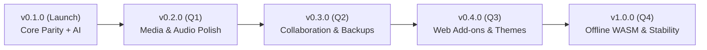

# Cardly Product Roadmap

This document outlines the development direction, upcoming milestones, and architectural vision for **Cardly** — the self-hosted, AGPL-3.0 web clone of Desktop Anki powered by upstream Rust `rslib` and Svelte 5.

---

## 🧭 Guiding Principles

1. **Strict Upstream Parity & Compatibility:**
   Never reinvent the card scheduler, database schema, or template engine. Always leverage upstream `rslib` to maintain 100% data compatibility with `.apkg`, `.colpkg`, and official Anki sync clients (AnkiDroid, AnkiMobile, Desktop).
2. **Privacy & True Self-Hosting:**
   Cardly belongs on your server. Zero telemetry, zero analytics tracking, zero third-party dependencies required for core functionality.
3. **Desktop Fidelity with Modern Web Ergonomics:**
   Keyboard-first navigation, instant response times (< 15 ms RPCs), sub-millisecond local caching, and seamless responsive design that scales from desktop multi-monitor workflows down to smartphones.
4. **Pragmatic Extensibility:**
   Provide high-impact modern additions (multimodal AI card generation, PWA, built-in sync server) without compromising core reliability.

---

## 🗺️ Milestones Overview

---

## 📦 Milestones Detail

### 🟢 v0.1.0 — Public Launch Baseline (Shipped 🎉)
*Focus: Full desktop parity, self-hosted sync server, mobile PWA, multimodal AI generation, single-command deployment.*

- [x] **Rust RPC Core:** Axum backend hosting upstream `rslib` via Protobuf binary RPC over HTTP.
- [x] **Desktop Parity UI:** Built with Svelte 5 runes (`web/`), matching desktop Anki layout, styling, and keybindings (`Space`, `1`-`4`, `Ctrl+Z`, `Ctrl+F`, `/`).
- [x] **Core Screens:** Deck List with hierarchical collapse/expand, Study/Reviewer, Add Note, Browse with advanced Anki search syntax, Stats graphs, Deck Options (including FSRS), Note Types editor, Preferences, Import/Export (`.apkg`, `.colpkg`, CSV).
- [x] **Built-in Anki Sync Server:** Full `/sync/*` and `/msync/*` endpoint support for seamless two-way synchronization with AnkiDroid, AnkiMobile, and Desktop Anki.
- [x] **Mobile PWA:** Responsive touch-friendly layout (44px touch targets), offline static asset caching via Service Worker, installable to iOS/Android home screens.
- [x] **Multimodal AI Card Generator:** Generate high-quality Basic and Cloze cards from raw text, lecture notes, textbook photos, and diagrams using Google Gemini, OpenAI/OpenRouter, or local Ollama with single-step undo (`Ctrl+Z`).
- [x] **Public Demo Mode:** Sandboxed trial mode with pre-seeded decks, 60-minute automatic reset, sliding rate-limiting, and destructive action protection.
- [x] **One-Command Deployment:** Production Docker Compose with multi-stage build, Caddy automatic Let's Encrypt TLS reverse proxy, and zero-downtime health checks.

---

### 🟡 v0.2.0 — Audio & Media Polish, Community Decks (Target: Q1)
*Focus: Deep multimedia support, in-browser recording, image masking, and starter content.*

- [ ] **In-Browser Audio Recorder:**
  - One-click microphone recording directly inside the card editor using Web Audio API.
  - Real-time audio waveform visualizer and non-destructive silence trimming.
- [ ] **Reviewer Audio Controls:**
  - Dedicated playback speed controls (`0.8x`, `1.0x`, `1.2x`, `1.5x`, `2.0x`) with hotkeys (`[` and `]`).
  - Auto-replay toggle and audio repeat hotkey (`R`).
- [ ] **Visual Image Occlusion Web Editor:**
  - Browser-native image occlusion note type editor: draw masks (rectangles, ellipses, polygons) directly on uploaded textbook diagrams.
  - Toggle individual mask vs. hide-all-reveal-one during review.
- [ ] **Configurable Hotkey Manager:**
  - Custom keybinding remapping interface in Preferences for all review, browse, and editor actions.
  - Pre-configured presets: Standard Anki, Vim-style (`j`/`k`/`h`/`l`), Single-Handed (`Q`/`W`/`E`/`R`).
- [ ] **Curated Community Starter Decks:**
  - Integrated starter deck repository for language learners (Top 3,000 English/Spanish/German/Kazakh words).
  - Standardized Kazakhstan UNT (ЕНТ) starter decks for History and Math.
- [ ] **Audio Text-to-Speech (TTS) Integration:**
  - Server-side and browser-native TTS generation (Web Speech API + optional Piper TTS) for vocabulary fields.

---

### 🔵 v0.3.0 — Collaboration & Enterprise Self-Hosting (Target: Q2)
*Focus: Multi-user administration, shared deck subscriptions, and automated cloud backup snapshots.*

- [ ] **Web Admin Dashboard:**
  - Instance administrator portal: manage users, view disk usage per collection, enforce storage quotas.
  - Server telemetry (active sync sessions, RPC response percentiles, SQLite database health checks).
- [ ] **Shared Decks & Read-Only Deck Subscriptions:**
  - Publish public or unlisted read-only deck links.
  - Subscribers pull card updates without losing personal scheduling intervals or review history.
- [ ] **Automated Cloud Backup Snapshots:**
  - Scheduled background backups to AWS S3, Cloudflare R2, Backblaze B2, or local mounted volumes.
  - One-click snapshot rollback with verification checksums.
- [ ] **Optional AnkiWeb Sync Relay:**
  - Bidirectional background bridge allowing users to sync their Cardly collection directly with an official `ankiweb.net` account.

---

### 🟣 v0.4.0 — Web Add-on & Theme Ecosystem (Target: Q3)
*Focus: Extensibility without compromising security, community themes, and advanced analytics.*

- [ ] **Sandboxed Web Add-on Architecture:**
  - Isolated Web Worker / WebAssembly execution runtime for community extensions.
  - Secure hook points: Reviewer bottom bar widgets, answer buttons modifications, custom card timer sounds, automated tagging rules.
- [ ] **Community Card Themes & Styling Gallery:**
  - One-click import and preview of card styles (e.g., Notion minimalist, Obsidian Dark, Cyberpunk, Academic Classic).
  - Live CSS variable inspector and real-time card preview.
- [ ] **Advanced Spaced Repetition Analytics v2:**
  - Visual FSRS parameter optimizer and simulation playground.
  - Interactive calendar heatmap (streaks, forecast workload, review heat by hour of day).
  - Retention by tag and deck difficulty breakdown.

---

### 🌟 v1.0.0 — Pure Offline WebAssembly & Native Desktop Shells (Target: Q4)
*Focus: 100% offline standalone web execution, native clients, and long-term stability.*

- [ ] **Client-Side `rslib` via WebAssembly (OPFS):**
  - Compile `rslib` directly to WASM and execute SQLite inside browser Origin Private File System (OPFS).
  - Enable 100% standalone, serverless offline Cardly that runs entirely in any browser tab without a backend server.
- [ ] **Native Desktop & Mobile Wrappers:**
  - Ultra-lightweight Tauri wrapper for macOS, Linux, and Windows (< 15 MB installer).
  - Android APK (Capacitor / TWA) with native system notifications and background sync.
- [ ] **Long-term Backward Compatibility Guarantee:**
  - Automated migration tests against every new upstream Anki database schema release.

---

## 🗳️ How Features are Prioritized

We prioritize features according to three criteria:
1. **Core Review Integrity:** Does this improve the speed, reliability, and accuracy of memorization?
2. **Desktop Parity:** Does this fix a gap where desktop Anki behaves differently or better?
3. **Self-Hosting Simplicity:** Can it run on a \$4/month VPS with minimal RAM without complex dependencies?

---

## 💡 How to Suggest or Vote on Features

We want Cardly to be shaped by the community:
- **Vote on Ideas:** Visit the [Cardly GitHub Discussions](https://github.com/cardly-app/cardly/discussions) and upvote features under **Ideas**.
- **Submit a Feature Request:** Open an issue using the [Feature Request Template](https://github.com/cardly-app/cardly/issues/new?template=feature_request.yml).
- **Contribute Code:** Check out [CONTRIBUTING.md](../CONTRIBUTING.md) and browse issues labeled [`good first issue`](https://github.com/cardly-app/cardly/labels/good%20first%20issue).
