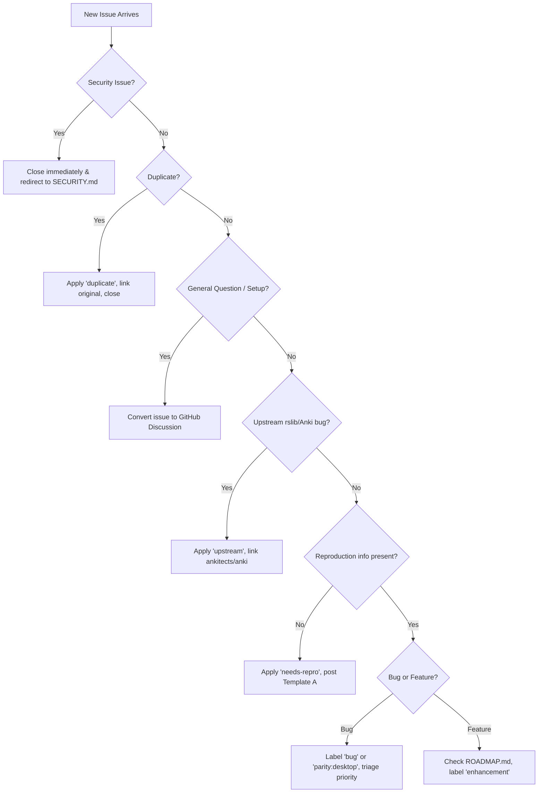

# Issue Triage Playbook for Cardly Maintainers

This guide provides a rapid triage workflow and ready-to-use canned responses designed to help maintainers process incoming issues in **under 2 minutes per issue** without burnout.

---

## ⏱️ The 2-Minute Triage Workflow



---

## 🏷️ Triage Checklist (< 120 Seconds)

1. **Read the title and first paragraph.**
2. **Apply appropriate labels immediately:**
   - Type: `bug`, `parity:desktop`, `enhancement`, `documentation`, `question`
   - Area: `area:sync`, `area:ai`, `area:reviewer`, `area:browse`, `area:docker`
   - Status: `needs-repro`, `upstream`, `good first issue`, `wontfix`
3. **If missing critical logs or steps:** Post **Template A** and label `needs-repro`.
4. **If upstream `rslib` limitation:** Post **Template B** and label `upstream`.
5. **If general question or configuration help:** Click **Convert to discussion** (`Q&A` category) and post **Template D**.
6. **Assign milestone** (e.g. `v0.1.x`, `v0.2.0`, `backlog`) if verified.

---

## 📋 Canned Responses (Copy & Paste)

### Template A: Needs Reproduction Information (English)
```markdown
Thanks for opening this issue! To help us reproduce and fix this quickly, could you please provide a bit more context?

1. **Environment:** Cardly version (or git commit hash), Docker version, OS, and Browser (Chrome/Firefox/Safari/mobile).
2. **Steps to reproduce:** What exact actions led to this behavior?
3. **Logs:**
   - Browser developer tools Console logs (`F12` -> Console tab)
   - Server Docker logs: `docker compose logs --tail=100 cardly`
4. **Sample card or deck:** If specific to certain cards, could you attach a minimal `.apkg` or example note?

Labeling as `needs-repro` for now. Once you provide this info, we'll dive right in!
```

### Template A (RU): Требуются шаги для воспроизведения
```markdown
Спасибо за репорт! Чтобы мы могли оперативно воспроизвести и исправить проблему, уточните, пожалуйста:

1. **Окружение:** Версия Cardly (или git commit), версия Docker, ОС и браузер (Chrome/Firefox/Safari/мобильный).
2. **Шаги для воспроизведения:** Какие конкретно действия приводят к ошибке?
3. **Логи:**
   - Ошибки из консоли браузера (`F12` -> вкладка Console)
   - Логи сервера: `docker compose logs --tail=100 cardly`
4. **Тестовая колода / карточка:** Если ошибка возникает на конкретных данных, прикрепите минимальный `.apkg`.

Пока ставлю метку `needs-repro`. Как только появятся детали, сразу разберемся!
```

---

### Template B: Upstream Anki Core (`rslib`) Issue (English)
```markdown
Thanks for reporting this!

Cardly uses the official upstream Anki Rust core (`rslib`) directly to guarantee 100% database and scheduler compatibility. The behavior you observed comes from `rslib` itself rather than the Cardly web shell or server.

- Upstream repository: https://github.com/ankitects/anki
- Relevant issue or discussion in upstream: [Link here if known]

Because this logic is governed by upstream, we cannot patch it independently without risking database schema desynchronization with official Anki clients. When upstream releases a fix, Cardly will incorporate it in the next core update.

Closing as `upstream`. Feel free to continue discussion if you think there is a web-wrapper workaround we can apply!
```

### Template B (RU): Поведение ядра Anki (`rslib`)
```markdown
Спасибо за информацию!

Cardly напрямую использует официальное ядро Anki на Rust (`rslib`), чтобы гарантировать 100% совместимость баз данных, планировщика и алгоритма FSRS. Поведение, о котором вы сообщили, исходит непосредственно из логики самого `rslib`, а не из веб-интерфейса или сервера Cardly.

- Репозиторий апстрима: https://github.com/ankitects/anki

Мы не модифицируем внутреннюю логику базы данных и планировщика отдельно, чтобы не нарушать совместимость с AnkiDroid и настольным Anki. Как только апстрим выпустит обновление, оно войдет в следующий релиз Cardly.

Закрываю с меткой `upstream`.
```

---

### Template C: Duplicate Issue (English)
```markdown
Thanks for pointing this out! This appears to be a duplicate of #{issue_number}.

To keep all discussion and debugging context consolidated in one place, I am closing this issue in favor of #{issue_number}. Please feel free to subscribe to that issue for updates and share any additional details there!
```

### Template C (RU): Дубликат существующего issue
```markdown
Спасибо! Похоже, эта проблема уже отслеживается в #{issue_number}.

Чтобы собрать все детали и ход решения в одном месте, закрываю этот тикет как дубликат #{issue_number}. Рекомендую подписаться на него для получения обновлений!
```

---

### Template D: Converting Question to Discussions (English)
```markdown
Thank you for reaching out! Since this is a question regarding configuration/self-hosting rather than a software defect in Cardly, I am converting this issue into a **GitHub Discussion** under the **Q&A & Self-Hosting** category so the community can also chime in and benefit from the answers.

Let's continue the conversation there!
```

### Template D (RU): Перенос вопроса в Discussions
```markdown
Спасибо за вопрос! Поскольку это вопрос по настройке/селф-хостингу, а не баг в самом коде Cardly, переношу тикет в раздел **GitHub Discussions** (категория **Q&A & Self-Hosting**), чтобы решение помогло и другим участникам сообщества.

Продолжим общение там!
```

---

### Template E: Feature Request Accepted / Added to Roadmap (English)
```markdown
Great idea! This aligns well with our vision for Cardly.

I have labeled this as `enhancement` and linked it to milestone **{milestone}** in our [Product Roadmap](https://github.com/cardly-app/cardly/blob/main/docs/ROADMAP.md).

If you or anyone in the community would like to take a stab at implementing this, check out our [CONTRIBUTING.md](https://github.com/cardly-app/cardly/blob/main/CONTRIBUTING.md) — PRs are warmly welcome!
```

---

### Template F: Stale / Inactive Issue Closure (English)
```markdown
Closing this issue due to lack of response for over 14 days following a `needs-repro` request.

If you are still experiencing this problem and can provide the requested reproduction steps or logs, please leave a comment and we will happily reopen the issue!
```

---

### Template G: Security Advisory Redirect (English)
```markdown
Thank you for bringing this to our attention. To protect users, please do not post potential security vulnerabilities or exploit details in public issues.

Please refer to our [Security Policy](https://github.com/cardly-app/cardly/blob/main/SECURITY.md) to report this confidentially via GitHub Security Advisories or email.

Closing this public issue now.
```

---

## 🛠️ Maintainer Debugging Quick-Commands

Useful one-liners when investigating bug reports locally:

```bash
# 1. Run server with full debug trace logs
RUST_LOG=cardly_server=trace,rslib=debug cargo run --bin cardly-server

# 2. Inspect SQLite collection schema directly
sqlite3 ./data/users/<username>/collection.anki2 ".schema"

# 3. Check card counts and note types in an existing database
sqlite3 ./data/users/<username>/collection.anki2 "SELECT count(*) FROM cards; SELECT count(*) FROM notes;"

# 4. Run automated integration test suite
cargo test --test integration

# 5. Run Playwright E2E tests headed (interactive browser view)
cd e2e && npx playwright test --headed

# 6. Verify Docker build on a clean machine
docker compose -f docker-compose.prod.yml build
```

---

## 🛡️ Maintainer Sustainability & SLA Principles

- **No Guilt on Inactive Days:** Open source is a marathon. A 48-hour response time is great; a 5-day response time during a busy work week is completely fine.
- **Polite But Firm Boundaries:** Do not spend hours debugging broken custom network topologies or non-standard reverse proxy configurations; redirect users to community Discussions.
- **Automate Everything:** Use issue templates, GitHub Actions for CI, and labels so that clean contributions can be merged with confidence.
