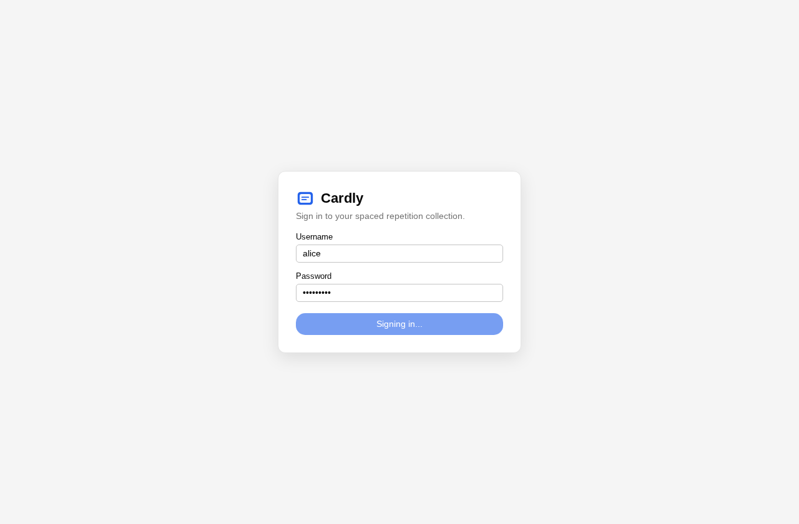
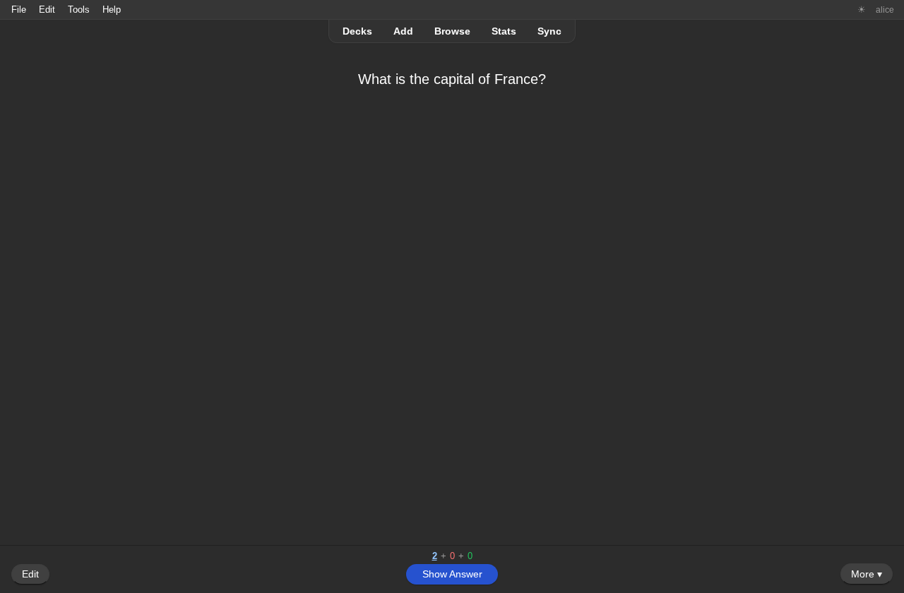
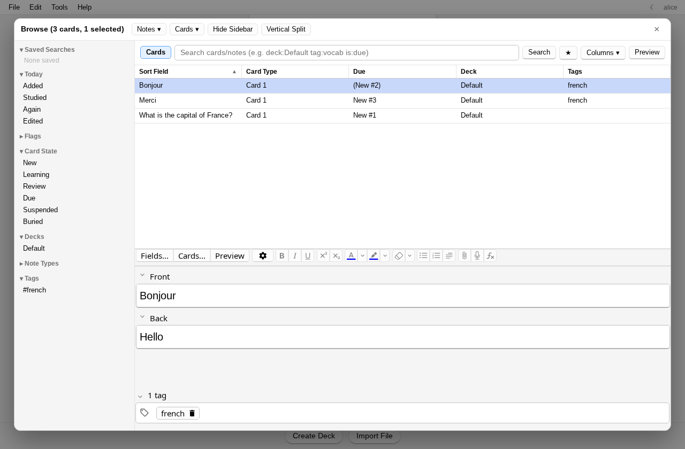
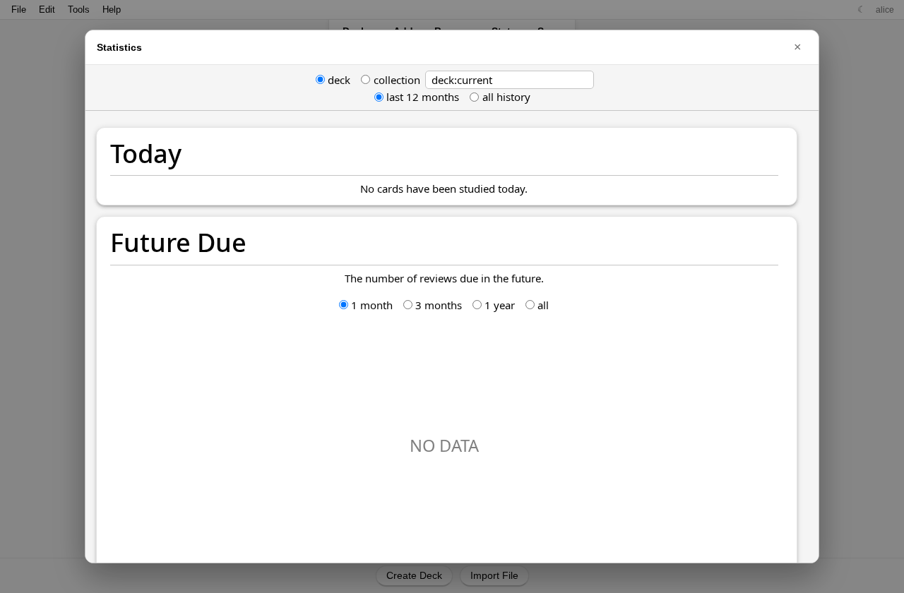
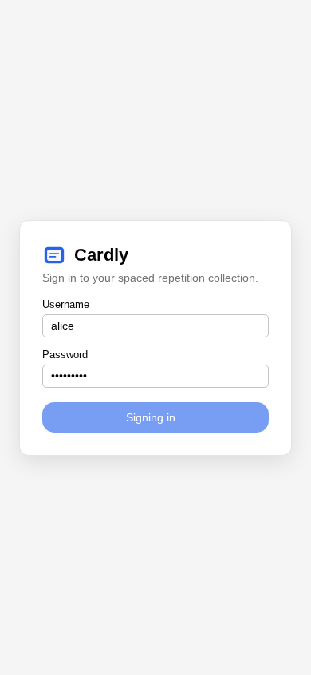

<p align="center">
  <picture>
    <source media="(prefers-color-scheme: dark)" srcset="../brand/cardly-logo-dark.svg">
    <source media="(prefers-color-scheme: light)" srcset="../brand/cardly-logo-light.svg">
    
  </picture>
</p>

<p align="center">
  <strong>Ресми Anki Rust өзегіне (<code>rslib</code>) негізделген жылдам, self-hosted веб-клиент.</strong>
</p>

<p align="center">
  <a href="../../LICENSE"></a>
  <a href="https://github.com/ankitects/anki"></a>
  <a href="#жылдам-іске-қосу"></a>
  <a href="../PARITY.md"></a>
</p>

<p align="center">
  <a href="../../README.md">English</a> • <a href="README.ru.md">Русский</a> • <b>Қазақша</b>
</p>

<p align="center">
  <a href="#жылдам-іске-қосу">Жылдам іске қосу</a> •
  <a href="#неге-cardly">Неге Cardly?</a> •
  <a href="#интерфейс-галереясы">Скриншоттар</a> •
  <a href="#ankiweb-және-desktop-anki-салыстыру">Салыстыру</a> •
  <a href="#мобильді-синхрондау">Мобильді синхрондау</a> •
  <a href="#баптаулар-параметрлері-env">Баптаулар</a> •
  <a href="../PARITY.md">Үйлесімділік кестесі</a>
</p>

---

<p align="center">
  
</p>

> **Құқықтық ескерту**: Cardly — дербес ашық бастапқы жоба. Жоба **Ankitects Pty Ltd компаниясымен немесе Дэмиен Элмспен ресми байланысты емес, олар тарапынан қаржыландырылмайды және қолдау таппаған**. «Anki» сауда белгісі оның заңды иесіне тиесілі. Cardly ресми Anki өзегін (`rslib`) GNU AGPL-3.0 лицензиясының талаптарына сәйкес пайдаланады.

---

## Жылдам іске қосу

Docker Compose арқылы іске қосу:

```bash
# 1. Репозиторийді субмодульдерімен бірге көшіріп алу
git clone --recurse-submodules https://github.com/OrkenSab/cardly.git
cd cardly

# 2. Баптау файлын дайындау
cp .env.example .env

# 3. Контейнерді іске қосу
docker compose up -d
```

Браузерде ашыңыз: **`http://localhost:8080`**. Кіру үшін `.env` файлында көрсетілген деректерді қолданыңыз (әдепкі: `alice` / `supersecretpassword`).

Тоқтату:
```bash
docker compose down
```

---

## Неге Cardly?

Desktop Anki тұрақты жұмыс істейді, бірақ әр құрылғыға Python және Qt тәуелділіктерін орнатуды талап етеді. AnkiWeb барлық жерде қолжетімді, алайда толық карточка шолғышы, үлгі редакторлары және FSRS оңтайландырғышы жоқ тек негізгі қарау интерфейсін ұсынады.

Cardly осы олқылықтың орнын толтырады — жеке серверде жұмыс істейтін толыққанды веб-кеңсе:

- **Ресми Anki Rust өзегі (`rslib`)**: Қайталау алгоритмдері JavaScript-те қайта жазылмаған немесе жуықталмаған. Уақыт аралығын есептеу, фаззинг және FSRS v4/v5 математикасы тікелей Anki-дің ресми Rust өзегінде орындалады.
- **Толық 3-панельді шолғыш**: 100 000-нан астам карточкасы бар үлкен коллекцияларды жылдам өңдейді. Anki іздеу синтаксисін (`deck:`, `tag:`, `is:due`, `prop:reps>5`), сақталған іздеулерді және жаппай өңдеу әрекеттерін (тоқтату, белгілеу, іздеу және ауыстыру, экспорт) қолдайды.
- **Кірістірілген синхрондау сервері**: AnkiDroid (Android) және AnkiMobile (iOS) ресми қосымшаларын сыртқы сервер баптауы арқылы Cardly-ге тікелей жалғауға болады.
- **Браузердегі FSRS оңтайландырғышы**: Қайталау тарихы бойынша 19 параметрлі FSRS коэффициенттерін жеке оқыту және есте сақтау болжамын есептеу.
- **Үлгілер мен медиа**: Клиенттік MathJax 3, құрамдас Cloze-бос орындар (`{{c1::...}}`), HTML5 аудио/видео, Image Occlusion және нақты уақыттағы HTML/CSS шаблондар редакторы.
- **Жасанды интеллект көмегімен генерация**: Жазбалардан немесе оқулық фотосуреттерінен жергілікті Ollama модельдері немесе бұлттық провайдерлер (Gemini, OpenAI, OpenRouter) арқылы карточка жасау.
- **Деректердің қауіпсіздігі мен резервтік көшірмелер**: Әр пайдаланушы үшін оқшауланған SQLite деректер қоры (`collection.anki2`) және медиа бумасы. Өзгерістер алдында автоматты түрде жасалатын көшірмелер.

---

## Интерфейс галереясы

| Колодалар тізімі | Күңгірт реңкте қайталау |
| :---: | :---: |
|  |  |
| **3-панельді карточкалар шолғышы** | **Статистика және есте сақтау болжамы** |
|  |  |

<p align="center">
  
  <br>
  <em>Мобильді PWA интерфейсі: төменгі навигация панелі, safe-area және ыңғайлы 44px тач-батырмалар.</em>
</p>

---

## AnkiWeb және Desktop Anki салыстыру

| Мүмкіндік | Desktop Anki | AnkiWeb | Cardly |
| :--- | :--- | :--- | :--- |
| **Ортасы** | Жергілікті бағдарлама (Python / PyQt6) | Жабық бұлттық сервис | Self-hosted веб-қосымша және PWA |
| **Жоспарлағыш өзегі** | Түпнұсқа `rslib` (Rust) | Арнайы веб-бэкенд | Түпнұсқа `rslib` (Rust) тікелей байланысқан |
| **FSRS v4 / v5** | Жоспарлағыш + Оптимизатор + Симулятор | Тек карточка қарау | Жоспарлағыш + Оптимизатор + Симулятор |
| **Карточкалар шолғышы** | Толық 3-панельді | Қарапайым тізім | Толық 3-панельді виртуалданған |
| **Үлгілер редакторы** | HTML/CSS қос терезелі редактор | Шектеулі | Тікелей алдын ала көру редакторы |
| **Формулалар мен медиа** | MathJax, LaTeX, аудио/видео | MathJax, негізгі аудио | MathJax 3, HTML5 медиа, Web TTS |
| **Синхрондау сервері** | Тек клиент | Бұлттық орталық сервер | Кірістірілген синхрондау сервері |
| **Мобильді қосылым** | Бөлек нативті қосымшалар | Қарапайым веб-бет | Орнатылатын PWA + мобильді синхрондау |
| **Деректерді сақтау** | Жергілікті диск | AnkiWeb серверлері | Жеке Docker көлемі (әр қолданушыға бөлек) |
| **Плагиндер** | PyQt Python плагиндері | Қолдамайды | Кірістірілген шешімдер (FSRS, ИИ, статистика) |

---

## Мобильді синхрондау

Cardly Anki-дің ресми синхрондау протоколын (`/sync/*` және `/msync/*`) толық қолдайды:

### AnkiDroid (Android)
1. AnkiDroid қосымшасында: **Баптаулар** &rarr; **Синхрондау** &rarr; **Жеке синхрондау сервері**.
2. **Жеке серверді пайдалану** құсбелгісін белгілеңіз.
3. **Синхрондау URL**: `http://<СЕРВЕР_IP>:8080/sync/`
4. **Медиа синхрондау URL**: `http://<СЕРВЕР_IP>:8080/msync/`
5. Негізгі экранға оралып, синхрондау батырмасын басып, `CARDLY_USER1` пайдаланушы аты мен құпиясөзін енгізіңіз.

### AnkiMobile (iOS)
1. AnkiMobile қосымшасында: **Preferences** &rarr; **Syncing** &rarr; **Custom Server**.
2. **Sync URL**: `http://<СЕРВЕР_IP>:8080/sync/`
3. Пайдаланушы аты мен құпиясөзді енгізіп, **Sync Now** батырмасын басыңыз.

> [!TIP]
> Серверді ғаламтор арқылы қолданған кезде Cardly-ді HTTPS прокси арқылы (Caddy немесе Nginx) қосып, `CARDLY_COOKIE_SECURE=true` мәнін орнату ұсынылады.

---

## Баптаулар параметрлері (`.env`)

| Айнымалы | Әдепкі мәні | Сипаттамасы |
| :--- | :--- | :--- |
| `CARDLY_PORT` | `8080` | Веб-интерфейс пен синхрондау серверінің порты. |
| `CARDLY_HOST` | `0.0.0.0` | Контейнер ішіндегі байланыстыру мекенжайы. |
| `CARDLY_DATA_DIR` | `./data` (хост) / `/data` (контейнер) | Деректер мен резервтік көшірмелер сақталатын орын. |
| `CARDLY_USER1` | *Міндетті* | Бірінші пайдаланушы деректері (`логин:құпиясөз`). |
| `CARDLY_USER2`, `...` | *Қосымша* | Қосымша пайдаланушы аккаунттары. |
| `PASSWORDS_HASHED` | `0` | Егер парольдер алдын ала өңделген PBKDF2 болса, `1` мәнін беріңіз. |
| `CARDLY_SESSION_SECRET` | *Автоматты* | Сессияны қорғауға арналған 256-биттік кілт. |
| `CARDLY_COOKIE_SECURE` | `false` | HTTPS прокси арқылы жұмыс істегенде `true` етіп қойыңыз. |
| `CARDLY_MAX_UPLOAD_MB` | `512` | Жүктелетін файлдар мен медианың ең үлкен көлемі (МБ). |
| `RUST_LOG` | `cardly_server=info,anki=info` | Сервер журналының деңгейі. |

---

## Жергілікті әзірлеу және сынақтар

Жобаны Docker-сіз өзгерту немесе іске қосу:

### Қажетті құралдар
- **Rust** 1.80+ (`cargo`)
- **Node.js** 20+ / 22+ (`npm`)
- **SQLite3** және **protobuf** құрастыру кітапханалары

### Құрастыру және іске қосу
```bash
# 1. Svelte 5 фронтендін құрастыру
cd web
npm install
npm run build
cd ..

# 2. Rust серверін іске қосу
CARDLY_USER1="alice:secret123" \
CARDLY_PORT=8080 \
CARDLY_SHELL_DIR="./web/dist" \
CARDLY_UPSTREAM_WEB_DIR="./anki-upstream/out/qt/_aqt/data/web" \
cargo run --manifest-path server/Cargo.toml
```

### Сынақтарды жүргізу
```bash
# Бэкендтің интеграциялық тесттері
cargo test --manifest-path server/Cargo.toml --test integration

# Фронтенд типтерін тексеру
npm --prefix web run check

# Playwright сквозды тесттері
npm --prefix e2e run test
```

---

## Құжаттама сілтемелері

- [Үйлесімділік есебі (`docs/PARITY.md`)](../PARITY.md) — әр мүмкіндіктің орындалу жағдайы.
- [ИИ-генератор нұсқаулығы (`docs/AI_GENERATOR.md`)](../AI_GENERATOR.md) — Ollama, Gemini және OpenAI қосу.
- [Серверге орнату (`docs/DEPLOY.md`)](../DEPLOY.md) — Caddy, TLS сертификаттары және резервтік көшірме.
- [Даму бағыттары (`docs/ROADMAP.md`)](../ROADMAP.md) — жоспарланған функционал мен идеялар.
- [Үлес қосу нұсқаулығы (`CONTRIBUTING.md`)](../../CONTRIBUTING.md) — код талаптары мен ережелер.

---

## Лицензия және құқықтар

Cardly жобасы **GNU Affero General Public License 3-нұсқасы немесе одан кейінгі нұсқалары** негізінде лицензияланған ([GNU AGPL-3.0-or-later](../../LICENSE)).

Cardly ресми Anki жобасына негізделген:
- **Бастапқы репозиторий**: [https://github.com/ankitects/anki](https://github.com/ankitects/anki)
- **Түпнұсқа авторы**: Damien Elmes және Anki қауымдастығы
- **Түпнұсқа лицензиясы**: GNU AGPL-3.0-or-later (жекелеген бөліктері BSD-3 және MIT лицензияларында)

Қосымша компоненттер мен ескертулер [NOTICE](../../NOTICE) файлында келтірілген.
