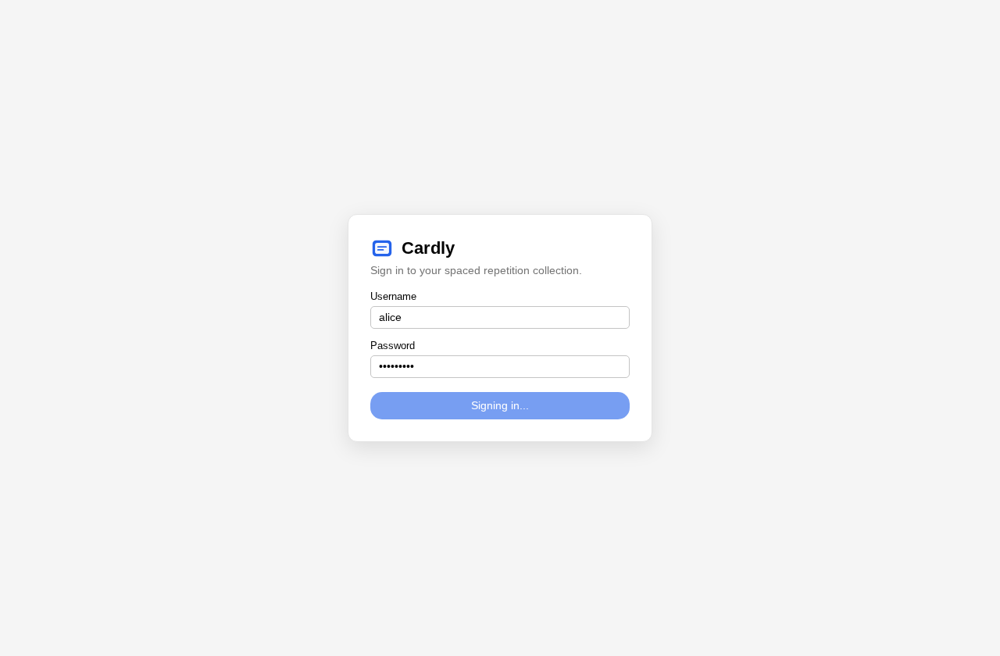
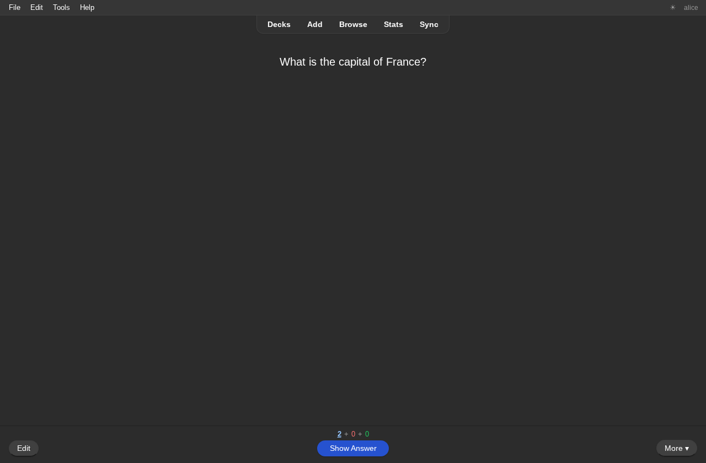
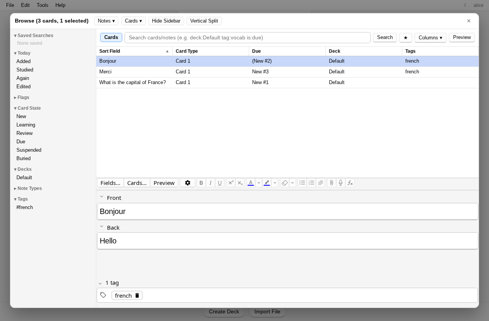
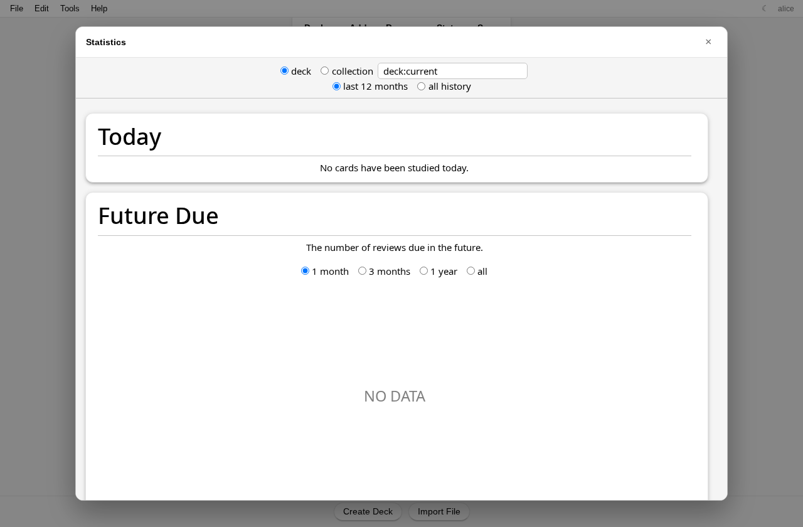
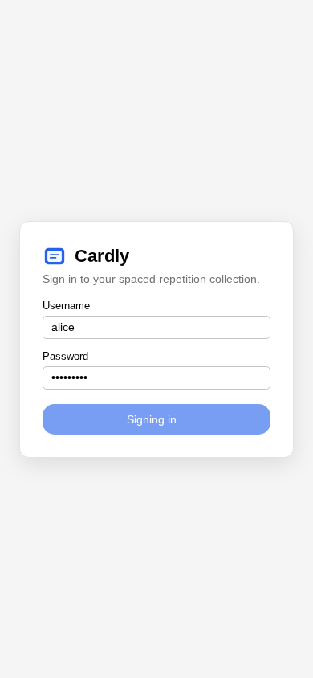

<p align="center">
  <picture>
    <source media="(prefers-color-scheme: dark)" srcset="../brand/cardly-logo-dark.svg">
    <source media="(prefers-color-scheme: light)" srcset="../brand/cardly-logo-light.svg">
    
  </picture>
</p>

<p align="center">
  <strong>Быстрый self-hosted веб-клиент для колод Anki на базе официального ядра Anki на Rust (<code>rslib</code>).</strong>
</p>

<p align="center">
  <a href="../../LICENSE"></a>
  <a href="https://github.com/ankitects/anki"></a>
  <a href="https://<YOUR_SUBDOMAIN>.duckdns.org"></a>
  <a href="#быстрый-старт"></a>
  <a href="../PARITY.md"></a>
</p>

<p align="center">
  <a href="../../README.md">English</a> • <b>Русский</b> • <a href="README.kk.md">Қазақша</a>
</p>

<p align="center">
  <a href="#быстрый-старт">Быстрый старт</a> •
  <a href="#почему-cardly">Почему Cardly</a> •
  <a href="#галерея-интерфейса">Скриншоты</a> •
  <a href="#сравнение-с-ankiweb-и-desktop-anki">Сравнение</a> •
  <a href="#синхронизация-с-мобильными-приложениями">Мобильная синхронизация</a> •
  <a href="#параметры-конфигурации-env">Конфигурация</a> •
  <a href="../PARITY.md">Таблица совместимости</a>
</p>

---

<p align="center">
  
</p>

> **Правовая оговорка**: Cardly — независимый проект с открытым исходным кодом. Проект **не аффилирован, не поддерживается и не спонсируется компанией Ankitects Pty Ltd или Дэмиеном Элмсом**. Название «Anki» является товарным знаком законного правообладателя. Cardly использует исходный код официальной библиотеки ядра Anki (`rslib`) на условиях лицензии GNU AGPL-3.0.

---

## 🌐 Публичная онлайн демо-версия

Опробуйте Cardly прямо в браузере без установки на свой компьютер:

👉 **[Открыть Live Demo](https://<YOUR_SUBDOMAIN>.duckdns.org)** *(Мгновенный гостевой вход без регистрации)*

> [!NOTE]
> **Ограничения демо-режима:**
> - **Периодический сброс данных**: Коллекция автоматически сбрасывается к эталонным демонстрационным колодам каждые 2 часа и при перезапуске сервера. Не используйте демо для постоянного личного обучения.
> - **AI-генератор**: Генерация карточек через нейросети отключена в демо во избежание перерасхода квот API. Разверните Cardly локально в Docker для подключения Ollama, Gemini или OpenAI.
> - **Лимиты ресурсов**: Размер загружаемых файлов ограничен 10 МБ, объем хранилища сессии — 50 МБ.

---

## Быстрый старт

Запуск через Docker Compose:

```bash
# 1. Клонирование репозитория вместе с субмодулями
git clone --recurse-submodules https://github.com/OrkenSab/cardly.git
cd cardly

# 2. Создание файла настроек
cp .env.example .env

# 3. Запуск контейнера
docker compose up -d
```

Откройте в браузере: **`http://localhost:8080`**. Войдите с логином и паролем из `.env` (по умолчанию: `alice` / `supersecretpassword`).

Остановить сервер:
```bash
docker compose down
```

---

## Почему Cardly?

Десктопная версия Anki надёжна, но требует установки Python и Qt-зависимостей на каждый рабочий компьютер. AnkiWeb доступен отовсюду, но предоставляет лишь базовый интерфейс повторения без полноценного браузера карточек, редактирования шаблонов и оптимизатора весов FSRS.

Cardly закрывает эту нишу — полноценная рабочая станция для колод Anki, работающая на вашем сервере в любом браузере и на смартфоне:

- **Официальное Rust-ядро Anki (`rslib`)**: Математика интервального повторения не переписывалась и не эмулировалась на JavaScript. Расчёт интервалов, фаззинг, кривые забывания и алгоритмы FSRS v4/v5 выполняются оригинальным кодом Anki.
- **Полноценный 3-панельный браузер**: Виртуализированный список, рассчитанный на коллекции из более чем 100 000 карточек. Поддерживает стандартные поисковые запросы Anki (`deck:`, `tag:`, `is:due`, `prop:reps>5`), сохранённые поиски и массовые операции (заморозка, теги, поиск и замена, экспорт).
- **Встроенный сервер синхронизации**: Приложения AnkiDroid (Android) и AnkiMobile (iOS) подключаются напрямую к вашему Cardly через стандартную настройку стороннего сервера синхронизации.
- **Оптимизатор FSRS прямо в браузере**: Обучение индивидуальных 19 параметров FSRS и расчёт симуляций удержания по истории ваших повторений без необходимости в Python-плагинах.
- **Шаблоны и медиа**: Клиентский MathJax 3, вложенные пропуски (`{{c1::...}}`), аудио/видео HTML5, Image Occlusion и сплит-редактор HTML/CSS с живым предпросмотром карточки.
- **Генератор карточек через ИИ**: Создание атомарных вопросов или пропусков (Cloze) по конспектам и фотографиям страниц учебника через локальные модели Ollama или облачные API (Gemini, OpenAI, OpenRouter).
- **Изоляция данных и резервное копирование**: Изолированные SQLite-базы (`collection.anki2`) и каталоги медиа для каждого пользователя. Автоматические снапшоты перед синхронизацией.

---

## Галерея интерфейса

| Список колод | Тёмная тема ревьюера |
| :---: | :---: |
|  |  |
| **3-панельный браузер карточек** | **Статистика и прогноз удержания** |
|  |  |

<p align="center">
  
  <br>
  <em>Мобильный режим PWA: нижняя панель навигации, отступы safe-area и комфортные тач-зоны от 44px.</em>
</p>

---

## Сравнение с AnkiWeb и Desktop Anki

| Возможность | Desktop Anki | AnkiWeb | Cardly |
| :--- | :--- | :--- | :--- |
| **Среда запуска** | Локально на ПК (Python / PyQt6) | Закрытый облачный сервис | Self-hosted веб-приложение и PWA |
| **Алгоритм повторений** | Оригинальный `rslib` (Rust) | Собственный веб-бэкенд | Оригинальный `rslib` (Rust) напрямую |
| **FSRS v4 / v5** | Планировщик + Оптимизатор + Симулятор | Только просмотр карточек | Планировщик + Оптимизатор + Симулятор |
| **Браузер карточек** | Полноценный 3-панельный | Простой список поиска | Полноценный 3-панельный виртуализированный |
| **Редактор шаблонов** | Двухоконный редактор HTML/CSS | Ограниченный | Двухоконный редактор с живым превью |
| **Формулы и медиа** | MathJax, LaTeX, аудио/видео | MathJax, базовое аудио | MathJax 3, HTML5 медиа, Web TTS |
| **Сервер синхронизации** | Только клиент | Облачный сервер | Встроенный сервер синхронизации |
| **Мобильный доступ** | Отдельные нативные клиенты | Базовая веб-страница | Устанавливаемый PWA + прямая синхронизация |
| **Хранение данных** | Локальный диск ПК | Серверы AnkiWeb | Собственный Docker-том (изолированно) |
| **Плагины** | Python-плагины PyQt | Не поддерживаются | Встроенные функции (FSRS, ИИ, статистика) |

---

## Синхронизация с мобильными приложениями

Cardly реализует официальный протокол синхронизации Anki (`/sync/*` и `/msync/*`):

### AnkiDroid (Android)
1. В AnkiDroid перейдите в **Настройки** &rarr; **Синхронизация** &rarr; **Свой сервер синхронизации**.
2. Включите **Использовать свой сервер**.
3. Укажите **URL синхронизации**: `http://<IP_СЕРВЕРА>:8080/sync/`
4. Укажите **URL синхронизации медиа**: `http://<IP_СЕРВЕРА>:8080/msync/`
5. На главном экране нажмите кнопку синхронизации и введите логин и пароль пользователя `CARDLY_USER1`.

### AnkiMobile (iOS)
1. В приложении AnkiMobile откройте **Preferences** &rarr; **Syncing** &rarr; **Custom Server**.
2. Укажите **Sync URL**: `http://<IP_СЕРВЕРА>:8080/sync/`
3. Введите логин и пароль, затем нажмите **Sync Now**.

> [!TIP]
> При выходе сервера в интернет рекомендуется размещать Cardly за обратным прокси (Caddy или Nginx) с HTTPS-сертификатом и задать `CARDLY_COOKIE_SECURE=true`.

---

## Параметры конфигурации (`.env`)

| Переменная | Значение по умолчанию | Описание |
| :--- | :--- | :--- |
| `CARDLY_PORT` | `8080` | Порт хоста для веб-интерфейса и синхронизации. |
| `CARDLY_HOST` | `0.0.0.0` | IP-адрес привязки внутри контейнера. |
| `CARDLY_DATA_DIR` | `./data` (хост) / `/data` (контейнер) | Каталог коллекций, медиафайлов и резервных копий. |
| `CARDLY_USER1` | *Обязательно* | Учётная запись первого пользователя (`логин:пароль`). |
| `CARDLY_USER2`, `...` | *Опционально* | Дополнительные аккаунты с изолированными базами. |
| `PASSWORDS_HASHED` | `0` | Установите `1`, если в `CARDLY_USER*` передаются готовые хеши PBKDF2. |
| `CARDLY_SESSION_SECRET` | *Генерируется автоматически* | Ключ подписи кук сессии. Сохраняется в `$CARDLY_DATA_DIR/.session_secret`. |
| `CARDLY_COOKIE_SECURE` | `false` | Установите `true` при работе через HTTPS-прокси. |
| `CARDLY_MAX_UPLOAD_MB` | `512` | Лимит размера загружаемых файлов `.apkg`, `.colpkg` и медиа (в МБ). |
| `RUST_LOG` | `cardly_server=info,anki=info` | Фильтр логирования бэкенда. |

---

## Локальная разработка и тестирование

Сборка и запуск без Docker:

### Требования к окружению
- **Rust** 1.80+ (`cargo`)
- **Node.js** 20+ / 22+ (`npm`)
- Библиотеки сборки **SQLite3** и **protobuf**

### Сборка и запуск
```bash
# 1. Сборка фронтенда на Svelte 5
cd web
npm install
npm run build
cd ..

# 2. Запуск сервера на Rust
CARDLY_USER1="alice:secret123" \
CARDLY_PORT=8080 \
CARDLY_SHELL_DIR="./web/dist" \
CARDLY_UPSTREAM_WEB_DIR="./anki-upstream/out/qt/_aqt/data/web" \
cargo run --manifest-path server/Cargo.toml
```

### Запуск тестов
```bash
# Интеграционные тесты бэкенда (Protobuf RPC и протокол синхронизации)
cargo test --manifest-path server/Cargo.toml --test integration

# Проверка типов фронтенда
npm --prefix web run check

# Сквозные Playwright e2e-тесты (десктопный и мобильный сценарии)
npm --prefix e2e run test
```

---

## Ссылки на документацию

- [Таблица совместимости с Anki (`docs/PARITY.md`)](../PARITY.md) — детальный отчёт по каждой функции.
- [Инструкция к ИИ-генератору (`docs/AI_GENERATOR.md`)](../AI_GENERATOR.md) — подключение Ollama, Gemini и OpenAI.
- [Руководство по деплою (`docs/DEPLOY.md`)](../DEPLOY.md) — настройка Caddy, HTTPS и бэкапов.
- [План развития (`docs/ROADMAP.md`)](../ROADMAP.md) — ближайшие задачи и идеи.
- [Участие в разработке (`CONTRIBUTING.md`)](../../CONTRIBUTING.md) — правила оформления кода и пулреквестов.

---

## Лицензия и авторские права

Cardly распространяется на условиях лицензии **GNU Affero General Public License версии 3 или более поздней** ([GNU AGPL-3.0-or-later](../../LICENSE)).

Проект базируется на наработках открытого проекта Anki:
- **Оригинальный репозиторий**: [https://github.com/ankitects/anki](https://github.com/ankitects/anki)
- **Автор и мейнтейнер оригинала**: Damien Elmes и сообщество контрибьюторов Anki
- **Лицензия оригинала**: GNU AGPL-3.0-or-later (отдельные компоненты под BSD-3 и MIT)

Полный перечень лицензий сторонних компонентов приведён в файле [NOTICE](../../NOTICE).
